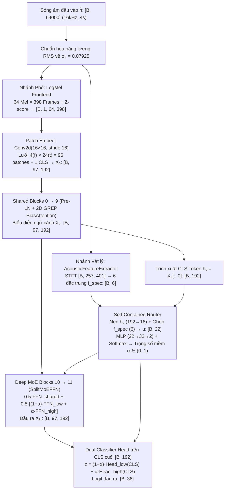

# Cẩm Nang Hướng Dẫn Triển Khai Từ Con Số 0: Kiến Trúc `CED-SingleMoE-SplitFFN` (Zero-Oracle)

Chào bạn! Trong tài liệu này, mình sẽ đóng vai trò là người hướng dẫn (mentor) đồng hành cùng bạn **viết lại toàn bộ dự án từ một thư mục trống** theo đúng chuẩn kỹ thuật nghiên cứu và sản xuất (production-grade PyTorch).

Thay vì chỉ đưa code cho bạn chép, ở mỗi bước chúng ta sẽ đi theo cấu trúc 4 phần:
1. **Tư duy thiết kế (Why):** Tại sao ta cần viết file này? Nếu viết khác đi thì gặp lỗi gì?
2. **Bản đồ toán học & Kích thước Tensor (Math & Shapes):** Đầu vào, đầu ra và công thức biến đổi.
3. **Triển khai code từng bước (Step-by-Step Code):** Code hoàn chỉnh kèm chú thích giải thích ý nghĩa từng khối lệnh.
4. **Kiểm chứng ngay lập tức (Verification):** Cách tự kiểm tra xem module vừa viết đã chạy đúng 100% chưa trước khi đi tiếp.

---

## Phần 0: Bức Tranh Tổng Thể & Thiết Lập Dự Án

### 0.1. Bài toán chúng ta đang giải quyết là gì?
Hệ thống nhận đầu vào là **nhiễu ước lượng $\hat{n}$** (dài 4 giây, tần số lấy mẫu $16\text{ kHz} \implies 64,000$ mẫu) được tách ra từ bộ khử nhiễu giọng nói **FRCRN**, với nhiệm vụ phân loại $\hat{n}$ vào **36 lớp âm thanh môi trường**.

**Thách thức vật lý cốt lõi:**
* **Ở vùng SNR thấp ($-5\text{ dB} \to 10\text{ dB}$):** Nhiễu môi trường rất lớn, FRCRN tách nhiễu khá sạch, giữ nguyên đặc trưng âm thanh nền.
* **Ở vùng SNR cao ($15\text{ dB} \to 20\text{ dB}$):** Giọng nói người quá lớn át hết nhiễu nền. Bộ tách FRCRN bị quá tải và làm **rò rỉ các âm tiết tiếng nói (speech leakage artifacts)** vào kênh nhiễu $\hat{n}$. Nếu dùng chung một mạng phân loại thông thường, mạng sẽ nhận diện nhầm các âm tiết tiếng nói rò rỉ này thành các lớp âm thanh khác.
* **Ràng buộc thực tế (Zero-Oracle):** Khi chạy thực tế (inference), không ai cho chúng ta biết mẫu âm thanh đang ở SNR bao nhiêu dB. Mô hình phải **tự nhìn vào tín hiệu $\hat{n}$ để biết nó đang ở vùng nào** và tự động điều phối chuyên gia xử lý tương ứng.

### 0.2. Sơ đồ luồng dữ liệu xuyên suốt toàn dự án



### 0.3. Khởi tạo cấu trúc thư mục
Bạn hãy tạo thư mục dự án theo đúng cấu trúc phân tầng dưới đây. Việc tách biệt `frontend`, `router`, `models`, `kd_trainer` và `pipeline` giúp code cực kỳ dễ đọc, dễ bảo trì và kiểm thử độc lập từng phần:

```text
kd-moe-ced/
├── config/
│   ├── config.yaml          # Cấu hình siêu tham số huấn luyện & mô hình
│   └── beat.yaml            # Cấu hình kiến trúc BEATs Teachers
├── src/
│   ├── __init__.py
│   ├── frontend.py          # Bước 1: Chuẩn hóa RMS, 6 đặc trưng vật lý, Log-Mel, SpecAugment
│   ├── router.py            # Bước 3: Bộ định tuyến nội tại tính α
│   ├── models/
│   │   ├── __init__.py
│   │   ├── vit_grep.py      # Bước 2: ViT Backbone, Patch Embed 16x16, Pre-LN, 2D GREP Attention
│   │   ├── split_moe.py     # Bước 4: SplitMoEFFN (Blocks 10-11), Dual Head & Model tổng thể
│   │   └── beat/            # Mô hình Giáo viên BEATs 12L
│   ├── dataset.py           # Bước 5A: Nạp dữ liệu Mixture-36L & Memory-mapped Cache
│   ├── kd_trainer.py        # Bước 5B: Động cơ huấn luyện Dual-Teacher KD + Consistent Mixup
│   ├── metrics.py           # Bước 6A: Tính Top-1, Top-3, mAP, AUC theo từng mức SNR
│   └── pipeline.py          # Bước 6B: Champion Pipeline suy luận với 3-Way TTA & Soft Blending
├── tests/                   # Bước 7: Bộ kiểm thử tự động xác minh toán học
│   ├── conftest.py
│   ├── test_frontend.py
│   ├── test_vit_grep.py
│   ├── test_router.py
│   ├── test_split_moe.py
│   └── test_end_to_end.py
├── train_kd_moe.py          # Script chạy huấn luyện
├── champion_pipeline.py     # Script chạy đánh giá suy luận
├── requirements.txt
└── pyproject.toml
```

---

## Bước 1: Xây dựng Tầng Frontend & 6 Đặc trưng Âm học (`src/frontend.py`)

### 1.1. Tư duy thiết kế
Khi sóng âm $\hat{n}$ đi vào hệ thống, sai lầm phổ biến nhất là đẩy thẳng vào Log-Mel Spectrogram. Tại sao?
1. Nếu không chuẩn hóa RMS trước, một đoạn âm thanh thu nhỏ (volume bé) và một đoạn âm thanh thu to sẽ có biên độ khác hẳn nhau, làm sai lệch hoàn toàn các phép đo năng lượng. Ta chuẩn hóa mọi mẫu về cùng mức **$\sigma_0 = 0.07925$** ($\approx -22.02\text{ dBFS}$).
2. Phổ Log-Mel chuẩn hóa z-score theo từng mẫu sẽ xóa mất thông tin về độ phẳng phổ tuyến tính và độ nhọn xung thời gian. Do đó, ngay sau bước chuẩn hóa RMS, ta phải **tách làm 2 nhánh song song**:
   * **Nhánh 1 (`AcousticFeatureExtractor`):** Dùng STFT tuyến tính ($N_{\text{fft}}=512, \text{hop}=160, \text{center}=\text{True}$) tạo ma trận công suất $P(f, t)$ kích thước **$257 \times 401$** để trích xuất 6 đặc trưng vật lý $f_{\text{spec}} \in \mathbb{R}^6$.
   * **Nhánh 2 (`LogMel` + `SpecAugment`):** Tạo ảnh phổ Mel kích thước **$64 \times 398$** chuẩn hóa z-score để đưa vào mạng Vision Transformer.

### 1.2. Bản đồ kích thước Tensor ở Bước 1
* Đầu vào `waveform`: $[B, 64000]$
* Qua `rms_normalize`: $[B, 64000]$ (có $\sqrt{\frac{1}{T}\sum x^2} = 0.07925$)
* Qua `AcousticFeatureExtractor`:
  * STFT Power $P(f, t)$: $[B, 257, 401]$ (vì $\frac{512}{2}+1 = 257$ tần số, $\frac{64000}{160}+1 = 401$ khung thời gian).
  * Đầu ra `features`: $[B, 6]$ gồm $[f_1, f_2, f_3, f_4, f_5, f_6]$.
* Qua `LogMel`: $[B, 1, 64, 398]$ (1 kênh ảnh, 64 dải tần Mel, 398 khung thời gian).

### 1.3. Triển khai code `src/frontend.py`

Bạn hãy tạo file `src/frontend.py` và viết lần lượt 4 thành phần sau:

```python
from __future__ import annotations

import numpy as np
import torch
import torch.nn as nn
import torch.nn.functional as F
from torch import Tensor

RMS_EPS = 1e-8
TARGET_RMS = 0.07925  # Mức năng lượng chuẩn tham chiếu (~ -22.02 dBFS)


# =====================================================================
# 1. HÀM CHUẨN HÓA NĂNG LƯỢNG RMS
# =====================================================================
def rms_normalize(waveform: Tensor, target_rms: float = TARGET_RMS) -> Tensor:
    """
    Đưa mọi tín hiệu sóng âm về cùng mức năng lượng hiệu dụng target_rms = 0.07925.
    Công thức: x_norm = x * (target_rms / (sqrt(mean(x^2)) + eps))
    """
    # Tính RMS dọc theo trục thời gian (dim=-1): [B, 64000] -> [B]
    rms = waveform.square().mean(dim=-1).sqrt()
    # Nhân hệ số tỷ lệ cho từng mẫu trong batch ([:, None] mở rộng chiều về [B, 1])
    return waveform * (target_rms / (rms + RMS_EPS))[:, None]


# =====================================================================
# 2. HÀM TẠO BỘ LỌC HTK MEL FILTERBANK THUẦN PYTORCH
# =====================================================================
def create_htk_mel_filterbank(
    sr: int = 16000,
    n_fft: int = 512,
    n_mels: int = 64,
    f_min: float = 20.0,
    f_max: float = 8000.0,
) -> Tensor:
    """
    Khởi tạo ma trận bộ lọc tam giác Mel theo chuẩn HTK: kích thước [64, 257].
    Viết thuần bằng NumPy/PyTorch để không phụ thuộc vào C++ extension của torchaudio.
    """
    # Chuyển tần số giới hạn Hz sang thang Mel: m = 2595 * log10(1 + f / 700)
    min_mel = 2595.0 * np.log10(1.0 + f_min / 700.0)
    max_mel = 2595.0 * np.log10(1.0 + f_max / 700.0)
    # Chia đều n_mels + 2 điểm trên thang Mel
    mel_pts = np.linspace(min_mel, max_mel, n_mels + 2)
    # Đổi ngược từ Mel về lại Hz: f = 700 * (10^(m / 2595) - 1)
    f_pts = 700.0 * (10.0 ** (mel_pts / 2595.0) - 1.0)
    # Tần số tuyến tính của 257 bins FFT (từ 0 Hz đến 8000 Hz)
    fft_freqs = np.linspace(0.0, sr / 2.0, n_fft // 2 + 1)

    weights = np.zeros((n_mels, n_fft // 2 + 1), dtype=np.float32)
    for i in range(n_mels):
        left, center, right = f_pts[i], f_pts[i + 1], f_pts[i + 2]
        # Sườn lên và sườn xuống của bộ lọc tam giác thứ i
        up = (fft_freqs - left) / (center - left)
        down = (right - fft_freqs) / (right - center)
        weights[i] = np.maximum(0.0, np.minimum(up, down))
    return torch.from_numpy(weights)


# =====================================================================
# 3. NHÁNH PHỔ LOG-MEL & SPECAUGMENT CHO BACKBONE VIT
# =====================================================================
class LogMel(nn.Module):
    """
    Biến đổi sóng âm [B, 64000] thành phổ Log-Mel chuẩn hóa z-score [B, 1, 64, 398].
    Khớp 100% với cấu hình tiền huấn luyện của CED-Tiny trên AudioSet.
    """
    def __init__(
        self,
        sample_rate: int = 16000,
        n_fft: int = 512,
        win_length: int = 400,
        hop_length: int = 160,
        n_mels: int = 64,
        f_min: float = 20.0,
        f_max: float = 8000.0,
        num_frames: int = 398,
        log_eps: float = 1e-6,
        norm_eps: float = 1e-5,
    ) -> None:
        super().__init__()
        self.n_fft = n_fft
        self.win_length = win_length
        self.hop_length = hop_length
        self.num_frames = num_frames
        self.log_eps = log_eps
        self.norm_eps = norm_eps
        # Đệm thêm (512 - 400) = 112 mẫu ở cuối để đủ cửa sổ FFT khi center=False
        self.pad = max(n_fft - win_length, 0)

        # Đăng ký buffer để window và mel_fb tự động chuyển sang GPU cùng model
        self.register_buffer("window", torch.hann_window(win_length))
        mel_fb = create_htk_mel_filterbank(sample_rate, n_fft, n_mels, f_min, f_max)
        self.register_buffer("mel_fb", mel_fb)

    def logmel(self, waveform: Tensor) -> Tensor:
        if self.pad:
            waveform = F.pad(waveform, (0, self.pad))
        # STFT với center=False: tạo ra (64112 - 512) // 160 + 1 = 398 khung thời gian
        stft = torch.stft(
            waveform,
            n_fft=self.n_fft,
            hop_length=self.hop_length,
            win_length=self.win_length,
            window=self.window,
            center=False,
            return_complex=True,
        )
        power = stft.abs().square()  # [B, 257, 398]
        # Nhân ma trận: [64, 257] @ [B, 257, 398] -> [B, 64, 398]
        mel = torch.matmul(self.mel_fb, power)
        return (mel + self.log_eps).log()

    def _offsets(self, frames: int, batch: int, device: torch.device) -> Tensor:
        limit = frames - self.num_frames
        if self.training and limit > 0:
            return torch.randint(0, limit + 1, (batch,), device=device)
        return torch.full((batch,), max(limit, 0) // 2, dtype=torch.long, device=device)

    def _crop(self, x: Tensor, offsets: Tensor) -> Tensor:
        frames = x.shape[-1]
        if frames <= self.num_frames:
            return x
        index = offsets[:, None] + torch.arange(self.num_frames, device=x.device)[None, :]
        return x.gather(2, index[:, None, :].expand(-1, x.shape[1], -1))

    def forward(self, waveform: Tensor) -> Tensor:
        x = self.logmel(waveform)  # [B, 64, 398]
        # Chuẩn hóa Z-score độc lập cho từng mẫu âm thanh trên cả 2 chiều (tần số, thời gian)
        mean = x.mean(dim=(-2, -1), keepdim=True)
        std = x.std(dim=(-2, -1), keepdim=True)
        x = (x - mean) / (std + self.norm_eps)
        # Cắt đúng 398 frames và thêm chiều kênh ảnh (dim=1) -> [B, 1, 64, 398]
        return self._crop(x, self._offsets(x.shape[-1], x.shape[0], x.device)).unsqueeze(1)


class SpecAugment(nn.Module):
    """
    Tăng cường dữ liệu bằng cách che ngẫu nhiên các dải tần số và thời gian (chỉ bật khi training).
    """
    def __init__(
        self,
        freq_masks: int = 2,
        freq_width: int = 8,
        time_masks: int = 2,
        time_width: int = 24,
    ) -> None:
        super().__init__()
        self.freq_masks = freq_masks
        self.freq_width = freq_width
        self.time_masks = time_masks
        self.time_width = time_width

    @staticmethod
    def _zero_band(x: Tensor, sample: int, dim: int, width: int) -> None:
        size = x.shape[dim]
        w = int(torch.randint(0, width + 1, (1,)).item())
        if w == 0 or w > size:
            return
        start = int(torch.randint(0, size - w + 1, (1,)).item())
        if dim == 2:
            x[sample, :, start : start + w, :] = 0
        else:
            x[sample, :, :, start : start + w] = 0

    def forward(self, x: Tensor) -> Tensor:
        if not self.training or (self.freq_masks == 0 and self.time_masks == 0):
            return x
        x = x.clone()
        for sample in range(x.shape[0]):
            for _ in range(self.freq_masks):
                self._zero_band(x, sample, dim=2, width=self.freq_width)
            for _ in range(self.time_masks):
                self._zero_band(x, sample, dim=3, width=self.time_width)
        return x


# =====================================================================
# 4. BỘ TRÍCH XUẤT 6 ĐẶC TRƯNG ÂM HỌC VẬT LÝ (KHÔNG CẦN NHÃN SNR)
# =====================================================================
class AcousticFeatureExtractor(nn.Module):
    """
    Trích xuất 6 đặc trưng vật lý f_spec ∈ R^[B, 6] từ sóng âm đã chuẩn hóa:
      - f1: Log-RMS (năng lượng tổng thể)
      - f2: Crest factor (tỷ số đỉnh / hiệu dụng)
      - f3: Kurtosis (độ nhọn phân phối năng lượng khung -> bắt xung rò rỉ tiếng nói)
      - f4: Spectral Flatness (độ phẳng phổ Wiener -> phân biệt nhiễu trắng và âm điều hòa)
      - f5: Tỷ số năng lượng dải trầm (<300 Hz) so với dải thoại (300-3400 Hz)
      - f6: Tỷ số năng lượng dải cao (>3400 Hz) so với dải thoại (300-3400 Hz)
    """
    def __init__(self, n_fft: int = 512, hop_length: int = 160) -> None:
        super().__init__()
        self.n_fft = n_fft
        self.hop_length = hop_length
        self.register_buffer("window", torch.hann_window(n_fft))

    def compute_stft_power(self, waveform: Tensor) -> Tensor:
        """
        Tính phổ công suất tuyến tính P(f, t) với center=True:
        Đầu ra có kích thước chính xác [B, 257, 401] cho đoạn âm thanh 64,000 mẫu.
        """
        stft = torch.stft(
            waveform,
            n_fft=self.n_fft,
            hop_length=self.hop_length,
            win_length=self.n_fft,
            window=self.window,
            center=True,
            return_complex=True,
        )
        return stft.abs().square()  # [B, 257, 401]

    def forward(self, waveform: Tensor) -> Tensor:
        eps = 1e-8

        # f1: Log-RMS
        rms = waveform.square().mean(dim=-1).clamp(min=eps).sqrt()
        log_rms = torch.log(rms + eps).unsqueeze(-1)  # [B, 1]

        # f2: Crest factor = max(|x|) / RMS
        peak = waveform.abs().max(dim=-1).values
        crest_factor = (peak / (rms + eps)).unsqueeze(-1)  # [B, 1]

        # Phổ công suất P(f, t): [B, 257, 401]
        power = self.compute_stft_power(waveform) + eps

        # f3: Kurtosis bậc 4 của năng lượng theo từng khung thời gian
        frame_energy = power.sum(dim=1)  # Tổng năng lượng theo tần số -> [B, 401]
        mean_fe = frame_energy.mean(dim=-1, keepdim=True)
        std_fe = frame_energy.std(dim=-1, keepdim=True) + eps
        kurtosis = (((frame_energy - mean_fe) / std_fe) ** 4).mean(dim=-1, keepdim=True)  # [B, 1]

        # f4: Spectral Flatness = Trung bình hình học / Trung bình số học theo trục tần số
        log_power = torch.log(power)
        geom_mean = torch.exp(log_power.mean(dim=1))  # [B, 401]
        arith_mean = power.mean(dim=1)                # [B, 401]
        flatness = (geom_mean / (arith_mean + eps)).mean(dim=-1, keepdim=True)  # [B, 1]

        # f5 & f6: Tỷ số năng lượng dải tần (Độ phân giải 1 bin = 16000 / 512 = 31.25 Hz)
        # - Bins 0..9:     0 Hz -> 312.5 Hz (Dải trầm < 300 Hz)
        # - Bins 10..108:  312.5 Hz -> 3406.25 Hz (Dải thoại 300 - 3400 Hz)
        # - Bins 109..256: 3406.25 Hz -> 8000 Hz (Dải cao > 3400 Hz)
        band_low = power[:, :10, :].sum(dim=(1, 2)) + eps
        band_speech = power[:, 10:109, :].sum(dim=(1, 2)) + eps
        band_high = power[:, 109:, :].sum(dim=(1, 2)) + eps

        ratio_low_speech = torch.log(band_low / band_speech).unsqueeze(-1)    # [B, 1]
        ratio_high_speech = torch.log(band_high / band_speech).unsqueeze(-1)  # [B, 1]

        # Ghép 6 đặc trưng lại thành [B, 6]
        return torch.cat(
            [log_rms, crest_factor, kurtosis, flatness, ratio_low_speech, ratio_high_speech],
            dim=-1,
        )
```

---

## Bước 2: Xây dựng Backbone ViT & Cơ chế 2D GREP (`src/models/vit_grep.py`)

### 2.1. Tư duy thiết kế
Một mạng Vision Transformer tiêu chuẩn (như DeiT-Tiny trên ImageNet) xử lý ảnh bằng cách cắt thành các ô vuông rồi dùng Positional Embedding 1D. Nhưng trên ảnh phổ âm thanh:
* Trục dọc là **Tần số** (64 dải Mel), trục ngang là **Thời gian** (398 khung). Hai trục này có bản chất vật lý hoàn toàn khác nhau!
* Khoảng cách tương đối giữa 2 ô patch $(\Delta f, \Delta t)$ quyết định cấu trúc hòa âm (harmonics) và nhịp điệu (rhythm).
* Hơn nữa, mức độ quan tâm đến khoảng cách không cố định mà phụ thuộc vào ngữ cảnh của chính âm thanh đó.

Vì vậy, ta xây dựng **CED-Tiny Backbone (`ViTSBias`)** với 3 điểm đặc biệt:
1. **Chia Patch 2D (`Conv2d 16x16, stride 16`):** Cắt phổ $64 \times 384$ thành lưới **$4 \text{ (tần số)} \times 24 \text{ (thời gian)} = 96\text{ patches}$**. Gắn thêm `CLS token` ở đầu thành **97 tokens**, mỗi token là vector **192 chiều**.
2. **Bảng vị trí tương đối 2D dùng chung (`SharedBias`):** Chỉ **Block 0** giữ bảng embedding khoảng cách $\Delta f \in [-3, 3]$ (7 mức) và $\Delta t \in [-23, 23]$ (47 mức) để sinh ra ma trận $P_{\text{rel}} \in \mathbb{R}^{1 \times 3 \times 97 \times 97}$. Các Block $1 \to 11$ dùng chung ma trận này qua con trỏ `SharedBias` để tiết kiệm bộ nhớ.
3. **Cổng điều biến động GREP (`BiasAttention`):** Từ Query $Q \in \mathbb{R}^{B \times 3 \times 97 \times 64}$, đi qua `Linear(64 -> 8)` và `Sigmoid` để sinh ra 2 cổng $g_a, g_b$. Hai cổng này điều biến biên độ của $P_{\text{rel}}$ theo công thức:
   $$S = g_a \odot (g_b \odot a - 1) + 2, \quad B_{\text{attn}} = S \odot P_{\text{rel}}$$
   Sau đó $B_{\text{attn}}$ được cộng trực tiếp vào $\frac{Q K^\top}{\sqrt{64}}$ trước khi qua Softmax.

### 2.2. Triển khai code `src/models/vit_grep.py`

```python
from __future__ import annotations

import timm
import torch
import torch.nn as nn
import torch.nn.functional as F
from torch import Tensor

GATE_HIDDEN = 8
CED_REPO = "mispeech/ced-tiny"
CED_PREFIX = "encoder."


class SharedBias:
    """
    Hộp chứa trung gian giúp Block 0 tính ma trận P_rel đúng 1 lần trong mỗi lượt forward,
    và các Block 1..11 chỉ việc đọc lại từ self.shared.value.
    """
    def __init__(self) -> None:
        self.value: Tensor | None = None


class BiasAttention(nn.Module):
    """
    Cơ chế chú ý có điều biến vị trí tương đối 2D (2D Gated Relative Position Bias - GREP).
    - Số head: H = 3
    - Chiều mỗi head: d_k = 64 (Tổng chiều C = 3 * 64 = 192)
    - Chuỗi token: T = 97 (1 CLS + 96 patches từ lưới 4x24)
    """
    def __init__(
        self,
        base: nn.Module,
        shared: SharedBias,
        owns_table: bool,
        freq_patches: int = 4,
        time_patches: int = 24,
        has_cls: bool = True,
        bias_init: str = "zero",
    ) -> None:
        super().__init__()
        self.has_cls = has_cls
        self.num_heads = base.num_heads  # 3 heads
        self.head_dim = base.head_dim    # 64 chiều
        # Tái sử dụng tầng chiếu QKV và tầng chiếu đầu ra từ timm Attention gốc
        self.qkv, self.proj = base.qkv, base.proj
        self.attn_drop, self.proj_drop = base.attn_drop, base.proj_drop
        self.shared = shared
        self.freq_patches = freq_patches
        self.time_patches = time_patches
        n_patches = freq_patches * time_patches  # 4 * 24 = 96

        # Chỉ Block 0 (owns_table=True) mới khởi tạo bảng tham số vị trí tương đối
        if owns_table:
            num_f = 2 * freq_patches - 1  # 2*4 - 1 = 7 khoảng cách tần số (-3..+3)
            num_t = 2 * time_patches - 1  # 2*24 - 1 = 47 khoảng cách thời gian (-23..+23)
            self.freq_rel_bias = nn.Embedding(num_f, self.num_heads)
            self.time_rel_bias = nn.Embedding(num_t, self.num_heads)
            # Bias riêng cho vị trí của token CLS (hàng 0 và cột 0)
            self.cls_to_patches = nn.Parameter(torch.zeros(1, self.num_heads, 1, n_patches))
            self.patches_to_cls = nn.Parameter(torch.zeros(1, self.num_heads, n_patches, 1))
            self.cls_to_cls = nn.Parameter(torch.zeros(1, self.num_heads, 1, 1))

            if bias_init in {"normal", "random"}:
                nn.init.normal_(self.freq_rel_bias.weight, std=0.01)
                nn.init.normal_(self.time_rel_bias.weight, std=0.01)
                nn.init.normal_(self.cls_to_patches, std=0.01)
                nn.init.normal_(self.patches_to_cls, std=0.01)
                nn.init.normal_(self.cls_to_cls, std=0.01)
            else:
                self.freq_rel_bias.weight.data.zero_()
                self.time_rel_bias.weight.data.zero_()

        # Cổng GREP riêng cho từng khối: chiếu từ 64 chiều xuống 8 chiều
        self.grep_linear = nn.Linear(self.head_dim, GATE_HIDDEN)
        # Hệ số nhân học được 'a' trong công thức S = g_a * (g_b * a - 1) + 2
        self.grep_a = nn.Parameter(torch.ones(1, self.num_heads, 1, 1))

    def compute_bias(self, device: torch.device) -> Tensor:
        """
        Tạo ma trận P_rel kích thước [1, 3, 97, 97] từ khoảng cách (delta_f, delta_t) giữa mọi cặp patch.
        """
        f_p, t_p = self.freq_patches, self.time_patches
        # Tọa độ tần số và thời gian của 96 patches
        grid_f = torch.arange(f_p, device=device).unsqueeze(1).expand(f_p, t_p).reshape(-1)
        grid_t = torch.arange(t_p, device=device).unsqueeze(0).expand(f_p, t_p).reshape(-1)

        # Hiệu khoảng cách giữa patch i và patch j, dịch dương để làm chỉ số tra bảng Embedding
        delta_f = (grid_f.unsqueeze(1) - grid_f.unsqueeze(0)) + (f_p - 1)  # [96, 96]
        delta_t = (grid_t.unsqueeze(1) - grid_t.unsqueeze(0)) + (t_p - 1)  # [96, 96]

        # Cộng bias tần số và thời gian: [96, 96, 3] -> [1, 3, 96, 96]
        bias_patch = (self.freq_rel_bias(delta_f) + self.time_rel_bias(delta_t)).permute(2, 0, 1).unsqueeze(0)
        if not self.has_cls:
            return bias_patch

        # Ghép thêm hàng 0 và cột 0 của token CLS -> [1, 3, 97, 97]
        row_cls = torch.cat([self.cls_to_cls, self.cls_to_patches], dim=-1)     # [1, 3, 1, 97]
        rows_patch = torch.cat([self.patches_to_cls, bias_patch], dim=-1)       # [1, 3, 96, 97]
        return torch.cat([row_cls, rows_patch], dim=-2)                         # [1, 3, 97, 97]

    def forward(self, x: Tensor, attn_mask: Tensor | None = None, is_causal: bool = False) -> Tensor:
        B, T, C = x.shape
        H, d = self.num_heads, self.head_dim

        # 1. Tính Q, K, V: mỗi tensor có kích thước [B, 3, 97, 64]
        q, k, v = self.qkv(x).reshape(B, T, 3, H, d).permute(2, 0, 3, 1, 4)

        # 2. Nếu là Block 0, tính P_rel và lưu vào self.shared.value
        if hasattr(self, "freq_rel_bias"):
            self.shared.value = self.compute_bias(x.device)
        position_bias = self.shared.value  # [1, 3, 97, 97]

        # 3. Cổng GREP điều biến biên độ theo ngữ cảnh của Query Q:
        # Linear(64 -> 8) -> gộp nhóm thành 2 cổng -> Sigmoid
        gate = torch.sigmoid(self.grep_linear(q).view(B, H, T, 2, GATE_HIDDEN // 2).sum(-1))
        gate_a, gate_b = gate.chunk(2, dim=-1)  # Mỗi cổng: [B, 3, 97, 1]
        scale = gate_a * (gate_b * self.grep_a - 1.0) + 2.0  # S: [B, 3, 97, 1]

        # 4. Nhân điều biến S với P_rel -> B_attn: [B, 3, 97, 97]
        bias = (scale * position_bias).to(q.dtype) if position_bias is not None else None

        # 5. Scaled Dot-Product Attention: Softmax(QK^T / sqrt(64) + B_attn) * V
        out = F.scaled_dot_product_attention(
            q, k, v, attn_mask=bias, dropout_p=self.attn_drop.p if self.training else 0.0
        )
        # Ghép lại 3 heads: [B, 3, 97, 64] -> [B, 97, 192]
        return self.proj_drop(self.proj(out.transpose(1, 2).reshape(B, T, C)))


class ViTSBias(nn.Module):
    """
    Backbone Vision Transformer 12 khối (Pre-LN) tích hợp 2D GREP BiasAttention.
    Mỗi khối có:
      - Nhánh 1: x = x + BiasAttention(LayerNorm1(x))
      - Nhánh 2: x = x + MLP(LayerNorm2(x))  (MLP: 192 -> 768 -> 192 với GELU, 295,872 tham số)
    """
    def __init__(
        self,
        num_classes: int = 36,
        freq_bins: int = 64,
        frames: int = 398,
        pretrained: bool = False,
        dropout: float = 0.0,
        attn_dropout: float = 0.0,
        drop_path: float = 0.0,
        arch: str = "deit_tiny_patch16_224",
        bias_init: str = "zero",
        use_bias: bool = True,
        time_major: bool = False,
    ) -> None:
        super().__init__()
        self.use_bias = use_bias
        self.time_major = time_major
        self.vit = timm.create_model(
            arch,
            pretrained=pretrained,
            in_chans=1,
            num_classes=num_classes,
            img_size=(freq_bins, frames),
            drop_rate=dropout,
            proj_drop_rate=dropout,
            attn_drop_rate=attn_dropout,
            drop_path_rate=drop_path,
        )
        self.freq_patches = freq_bins // 16  # 64 // 16 = 4
        self.time_patches = frames // 16     # 398 // 16 = 24
        self.frames = frames
        self.shared = SharedBias()

        # Thay thế Attention mặc định của cả 12 khối bằng BiasAttention (2D GREP)
        for index, block in enumerate(self.vit.blocks):
            if use_bias:
                block.attn = BiasAttention(
                    block.attn,
                    self.shared,
                    owns_table=(index == 0),  # Chỉ Block 0 giữ bảng
                    freq_patches=self.freq_patches,
                    time_patches=self.time_patches,
                    has_cls=True,
                    bias_init=bias_init,
                )

    def forward(self, x: Tensor) -> Tensor:
        vit = self.vit
        x = vit.patch_embed(x[..., : self.frames])  # [B, 96, 192]
        x = x + vit.pos_embed[:, 1:]
        B, N, C = x.shape
        if self.time_major:
            x = x.view(B, self.freq_patches, self.time_patches, C).transpose(1, 2).reshape(B, N, C)
        cls = (vit.cls_token + vit.pos_embed[:, :1]).expand(B, -1, -1)
        x = vit.norm_pre(vit.pos_drop(torch.cat([cls, x], dim=1)))  # [B, 97, 192]
        self.shared.value = None
        x = vit.blocks(x)
        x = vit.norm(x)
        return vit.forward_head(x)


def load_ced_tiny(model: ViTSBias, repo: str = CED_REPO, path: str | None = None) -> dict[str, int]:
    """
    Tải trọng số tiền huấn luyện AudioSet của CED-Tiny và nội suy lưới Positional Embedding 2D (4 x 24).
    """
    from huggingface_hub import hf_hub_download
    from safetensors.torch import load_file

    try:
        local = path or hf_hub_download(repo, "model.safetensors")
        state = load_file(local)
    except Exception as exc:
        print(f"Warning: Không tải được CED-Tiny weights ({exc}). Sử dụng trọng số khởi tạo.")
        return {"loaded_tensors": 0, "total_tensors": 0, "missing": 0}

    vit = model.vit
    mapped = {k[len(CED_PREFIX) :]: v for k, v in state.items() if k.startswith(CED_PREFIX + "blocks.")}
    mapped.update(
        {
            k[len(CED_PREFIX) :]: v
            for k, v in state.items()
            if k.startswith((CED_PREFIX + "patch_embed.", CED_PREFIX + "norm."))
        }
    )
    own = vit.state_dict()
    mapped = {k: v for k, v in mapped.items() if k in own and own[k].shape == v.shape}
    result = vit.load_state_dict(mapped, strict=False)

    # Nội suy Positional Embedding 2D từ tách biệt tần số (freq_pos_embed) và thời gian (time_pos_embed)
    if (CED_PREFIX + "freq_pos_embed") in state and (CED_PREFIX + "time_pos_embed") in state:
        freq = state[CED_PREFIX + "freq_pos_embed"][0, :, :, 0]
        time = state[CED_PREFIX + "time_pos_embed"][0, :, 0, :]
        if freq.shape[1] != model.freq_patches:
            freq = F.interpolate(freq[None], size=model.freq_patches, mode="linear", align_corners=False)[0]
        time = time[:, : model.time_patches]
        if time.shape[1] >= model.time_patches:
            grid = freq[:, :, None] + time[:, None, :]
            pos = grid.permute(1, 2, 0).reshape(1, model.freq_patches * model.time_patches, -1)
            vit.pos_embed.data[:, 1:] = pos.to(vit.pos_embed.dtype)

    return {"loaded_tensors": len(mapped), "total_tensors": len(own), "missing": len(result.missing_keys)}
```

---

## Bước 3: Xây dựng Router Nội tại Không cần Nhãn SNR (`src/router.py`)

### 3.1. Tư duy thiết kế
Sau khi dữ liệu đi qua **Blocks $0 \to 9$**, ta dừng lại một nhịp để hỏi Router: *"Mẫu âm thanh này đang nằm ở vùng nhiễu mạnh (Low-SNR) hay vùng giả ảnh rò rỉ tiếng nói (High-SNR)?"*

**Tại sao thiết kế Router như sơ đồ 7 bước của chúng ta?**
1. **Lấy `CLS token` $h_9 \in \mathbb{R}^{192}$ sau Block 9:** Ở tầng thứ 10 này, token CLS đã tích lũy đủ ngữ nghĩa âm học cấp cao của cả đoạn âm thanh.
2. **Nén $192 \to 16$ chiều trước khi ghép với $f_{\text{spec}} \in \mathbb{R}^6$:**
   * Nếu bạn ghép thẳng $192$ chiều với $6$ chiều vật lý, tỷ lệ chiều là $192 : 6 = 32 : 1$. Lớp tuyến tính phía sau sẽ bị áp đảo hoàn toàn bởi 192 chiều của token và phớt lờ 6 đặc trưng vật lý.
   * Khi nén xuống $16$ chiều ($\tilde{h}_9 \in \mathbb{R}^{16}$), tỷ lệ là $16 : 6 \approx 2.6 : 1$, giúp mô hình kết hợp hài hòa cả **bằng chứng vật lý thô** lẫn **ngữ nghĩa học sâu**.
3. **Đầu ra $\alpha \in (0, 1)$ mềm qua Softmax:**
   * Thay vì cắt cứng `if snr >= 18: ...`, ta dùng xác suất của nhánh High: $\alpha = \frac{\exp(r_{\text{high}})}{\exp(r_{\text{low}}) + \exp(r_{\text{high}})}$.
   * Trong lúc huấn luyện, ta dạy Router bằng một nhãn mục tiêu mượt theo hàm Sigmoid:
     $$y_{\text{target}} = \sigma\left(\frac{\text{SNR} - 15.0}{2.5}\right)$$
     Tại $-5\text{ dB} \implies y_{\text{target}} \approx 0.0003$; tại $15\text{ dB} \implies y_{\text{target}} = 0.50$; tại $20\text{ dB} \implies y_{\text{target}} \approx 0.8808$.

### 3.2. Triển khai code `src/router.py`

```python
from __future__ import annotations

import torch
import torch.nn as nn
import torch.nn.functional as F
from torch import Tensor


class SelfContainedSpectralTokenRouter(nn.Module):
    """
    Bộ định tuyến nội tại ước lượng trọng số mềm alpha ∈ (0, 1) hoàn toàn không cần nhãn SNR lúc suy luận.
    Luồng dữ liệu:
      1. h_9 [B, 192] -> LN -> Linear(192, 16) -> GELU -> h_tilde_9 [B, 16]
      2. Ghép u = [f_spec || h_tilde_9] -> [B, 22]
      3. MLP: Linear(22, 32) -> LN -> GELU -> Linear(32, 2) -> [r_low, r_high]
      4. Softmax -> alpha = exp(r_high) / (exp(r_low) + exp(r_high)) ∈ (0, 1)
    """
    def __init__(
        self,
        spectral_dim: int = 6,
        token_dim: int = 192,
        token_proj_dim: int = 16,
        hidden_dim: int = 32,
        transition_center_db: float = 15.0,
        transition_tau: float = 2.5,
    ) -> None:
        super().__init__()
        self.transition_center_db = transition_center_db
        self.transition_tau = transition_tau

        # Nhánh nén CLS token từ 192 chiều xuống 16 chiều (3,088 tham số)
        self.token_proj = nn.Sequential(
            nn.LayerNorm(token_dim),
            nn.Linear(token_dim, token_proj_dim),
            nn.GELU(),
        )

        # MLP tương tác chéo giữa đặc trưng vật lý và ngữ nghĩa (22 -> 32 -> 2)
        in_total = spectral_dim + token_proj_dim
        self.mlp = nn.Sequential(
            nn.Linear(in_total, hidden_dim),
            nn.LayerNorm(hidden_dim),
            nn.GELU(),
            nn.Linear(hidden_dim, 2),  # Xuất 2 logit: [r_low, r_high]
        )

    def forward(
        self,
        spectral_feat: Tensor,
        intermediate_token: Tensor,
    ) -> tuple[Tensor, Tensor]:
        # Bước 1: Nén token [B, 192] -> [B, 16]
        token_h = self.token_proj(intermediate_token)
        # Bước 2: Ghép nối [B, 6] và [B, 16] -> [B, 22]
        fused_feat = torch.cat([spectral_feat, token_h], dim=-1)
        # Bước 3: Tính 2 logit [r_low, r_high]
        logits = self.mlp(fused_feat)
        # Bước 4: Chuẩn hóa Softmax lấy trọng số nhánh High
        gates = F.softmax(logits, dim=-1)  # [B, 2]
        alpha = gates[:, 1:2]              # [B, 1]
        return alpha, gates

    def compute_target_soft_label(self, snr_db: Tensor) -> Tensor:
        """
        Tạo nhãn mềm liên tục từ SNR (chỉ dùng trong quá trình training để dạy Router).
        """
        z = (snr_db.float() - self.transition_center_db) / self.transition_tau
        return torch.sigmoid(z).unsqueeze(-1)

    def compute_router_loss(self, alpha: Tensor, snr_db: Tensor) -> Tensor:
        """
        Hàm mất mát Binary Cross-Entropy giám sát Router.
        """
        target = self.compute_target_soft_label(snr_db)
        return F.binary_cross_entropy(alpha.float().clamp(1e-6, 1.0 - 1e-6), target.float())
```

---

## Bước 4: Xây dựng `SplitMoEFFN`, `Dual Head` & Ghép nối Toàn Mô hình (`src/models/split_moe.py`)

### 4.1. Tư duy thiết kế: Nguyên lý Vàng "Identity Warm-Start"
Ở **Blocks 10 và 11**, ta thay thế tầng MLP đơn lẻ (295,872 tham số) bằng khối **`SplitMoEFFN`** gồm 3 nhánh chạy song song:
* `ffn_shared`: Luôn nhận hệ số cố định **$0.5$** (giữ biểu diễn nền tảng chung cho mọi mức SNR).
* `ffn_low`: Nhận hệ số **$0.5 \cdot (1 - \alpha)$** (chuyên trách vùng nhiễu mạnh Low-SNR).
* `ffn_high`: Nhận hệ số **$0.5 \cdot \alpha$** (chuyên trách vùng giả ảnh rò rỉ tiếng nói High-SNR).

**Tại sao công thức tổ hợp lồi này lại quan trọng đến vậy?**
Khi khởi tạo, cả 3 nhánh đều được copy nguyên vẹn (`copy.deepcopy`) từ trọng số MLP đã tiền huấn luyện của CED-Tiny ($M_0$). Khi đó, tại bước huấn luyện đầu tiên (step 0), với **bất kỳ giá trị $\alpha$ nào** mà Router sinh ra:
$$y = 0.5 \cdot M_0(x) + 0.5 \cdot \left[(1 - \alpha) M_0(x) + \alpha M_0(x)\right] = 0.5 \cdot M_0(x) + 0.5 \cdot M_0(x) = M_0(x)$$
Đầu ra của khối MoE **bằng chính xác tuyệt đối** đầu ra của CED-Tiny gốc! Nếu bạn không nhân $0.5$ mà cộng trực tiếp $\text{FFN}_{\text{shared}} + \text{FFN}_{\text{routed}}$, biên độ kích hoạt sẽ bị **nhân đôi ($2.0 \times M_0(x)$)**, làm hỏng ngay lập tức phân phối LayerNorm ở tầng cuối.

### 4.2. Triển khai code `src/models/split_moe.py`

```python
from __future__ import annotations

import copy
import torch
import torch.nn as nn
from torch import Tensor

from src.frontend import AcousticFeatureExtractor, LogMel, SpecAugment, rms_normalize
from src.models.vit_grep import ViTSBias, load_ced_tiny
from src.router import SelfContainedSpectralTokenRouter


class SplitMoEFFN(nn.Module):
    """
    Khối MoE FFN đặt tại Blocks 10 & 11:
      y = 0.5 * FFN_shared(x) + 0.5 * [(1 - alpha) * FFN_low(x) + alpha * FFN_high(x)]
    Bảo toàn tuyệt đối phân phối kích hoạt (Identity Warm-Start) tại thời điểm khởi tạo.
    """
    def __init__(self, base_mlp: nn.Module) -> None:
        super().__init__()
        # Sao chép nguyên vẹn trọng số MLP gốc của CED-Tiny cho cả 3 chuyên gia
        self.ffn_shared = copy.deepcopy(base_mlp)
        self.ffn_low = copy.deepcopy(base_mlp)
        self.ffn_high = copy.deepcopy(base_mlp)

    def forward(self, x: Tensor, alpha: Tensor) -> Tensor:
        # x: [B, 97, 192], alpha: [B, 1] -> mở rộng alpha thành [B, 1, 1] để nhân broadcast
        if alpha.ndim == 2:
            alpha = alpha.unsqueeze(1)

        out_shared = self.ffn_shared(x)
        out_low = self.ffn_low(x)
        out_high = self.ffn_high(x)

        routed_out = (1.0 - alpha) * out_low + alpha * out_high
        return 0.5 * out_shared + 0.5 * routed_out


class CEDSingleMoESplitFFN(nn.Module):
    """
    Kiến trúc Student hoàn chỉnh (~6.62M tham số):
    n̂ -> RMS Norm -> (6 Features + LogMel) -> Patch Embed -> Shared Blocks 0..9
      -> Router α -> SplitMoEFFN Blocks 10..11 -> Dual Classifier Head -> Logits [B, 36]
    """
    def __init__(
        self,
        num_classes: int = 36,
        freq_bins: int = 64,
        frames: int = 398,
        split_blocks: tuple[int, ...] = (10, 11),
        dropout: float = 0.0,
        load_pretrained: bool = False,
    ) -> None:
        super().__init__()
        self.split_blocks = split_blocks
        self.num_classes = num_classes

        # 1. Tầng Frontend
        self.frontend = LogMel(n_mels=freq_bins, num_frames=frames)
        self.spec_augment = SpecAugment()
        self.acoustic_extractor = AcousticFeatureExtractor()

        # 2. Tầng Backbone CED-Tiny (Pre-LN + 2D GREP)
        self.vit_base = ViTSBias(
            num_classes=num_classes,
            freq_bins=freq_bins,
            frames=frames,
            pretrained=False,
            dropout=dropout,
            use_bias=True,
            time_major=False,
        )
        if load_pretrained:
            load_ced_tiny(self.vit_base)

        # 3. Bộ định tuyến nội tại (Router)
        self.router = SelfContainedSpectralTokenRouter(
            spectral_dim=6,
            token_dim=192,
            token_proj_dim=16,
            hidden_dim=32,
        )

        # 4. Nâng cấp MLP ở Blocks 10 & 11 thành SplitMoEFFN
        self.moe_blocks: dict[int, SplitMoEFFN] = {}
        for block_idx in self.split_blocks:
            original_mlp = self.vit_base.vit.blocks[block_idx].mlp
            moe_mlp = SplitMoEFFN(original_mlp)
            self.vit_base.vit.blocks[block_idx].mlp = moe_mlp
            self.moe_blocks[block_idx] = moe_mlp

        # 5. Đầu phân loại kép (Dual Classifier Head: 192 -> 36)
        original_head = self.vit_base.vit.head
        self.head_low = copy.deepcopy(original_head)
        self.head_high = copy.deepcopy(original_head)

    def forward(
        self,
        waveform: Tensor,
        return_dict: bool = False,
    ) -> dict[str, Tensor] | Tensor:
        # Bước 1: Chuẩn hóa năng lượng RMS về 0.07925
        wave_norm = rms_normalize(waveform)

        # Bước 2: Rút trích 6 đặc trưng vật lý f_spec [B, 6]
        spectral_feat = self.acoustic_extractor(wave_norm)

        # Bước 3: Tính phổ Log-Mel [B, 1, 64, 398] (luôn chạy ở FP32 để chính xác)
        with torch.autocast(waveform.device.type, enabled=False):
            mel = self.frontend(wave_norm.float())
        mel_aug = self.spec_augment(mel)

        # Bước 4: Cắt Patch 16x16 + Gắn CLS Token + Cộng 2D Pos Embed -> X_0 [B, 97, 192]
        vit = self.vit_base.vit
        x = vit.patch_embed(mel_aug[..., : self.vit_base.frames])
        x = x + vit.pos_embed[:, 1:]
        B, N, C = x.shape
        cls = (vit.cls_token + vit.pos_embed[:, :1]).expand(B, -1, -1)
        x = vit.norm_pre(vit.pos_drop(torch.cat([cls, x], dim=1)))

        # Reset bộ nhớ đệm P_rel trước khi qua Block 0
        self.vit_base.shared.value = None

        # Bước 5: Đi qua 10 khối dùng chung (Blocks 0 -> 9)
        for i in range(10):
            x = vit.blocks[i](x)

        # Lấy CLS token sau Block 9: h_9 [B, 192]
        block9_token = x[:, 0]

        # Bước 6: Router tính trọng số điều phối mềm alpha ∈ (0, 1)
        alpha, gates = self.router(spectral_feat, block9_token)

        # Bước 7: Đi qua các khối MoE sâu (Blocks 10 -> 11)
        for i in self.split_blocks:
            block = vit.blocks[i]
            # Nhánh 1 (Pre-LN Attention + Residual 1)
            x = x + block.drop_path1(block.ls1(block.attn(block.norm1(x))))
            # Nhánh 2 (Pre-LN SplitMoEFFN theo alpha + Residual 2)
            moe_mlp = block.mlp
            normed_x = block.norm2(x)
            mlp_out = moe_mlp(normed_x, alpha)
            x = x + block.drop_path2(block.ls2(mlp_out))

        # Bước 8: Chuẩn hóa cuối và trộn Dual Classifier Head theo alpha
        x = vit.norm(x)
        cls_final = x[:, 0]  # [B, 192]

        logits_low = self.head_low(cls_final)    # [B, 36]
        logits_high = self.head_high(cls_final)  # [B, 36]

        # Trộn mềm logit cuối: z = (1 - alpha) * z_low + alpha * z_high
        logits_fused = (1.0 - alpha) * logits_low + alpha * logits_high

        if return_dict:
            return {
                "logits": logits_fused,
                "logits_low": logits_low,
                "logits_high": logits_high,
                "alpha": alpha,
                "gates": gates,
                "spectral_feat": spectral_feat,
                "block9_token": block9_token,
            }
        return logits_fused
```

Đừng quên tạo file `src/models/__init__.py` để xuất các class ra gọn gàng:
```python
from src.models.split_moe import CEDSingleMoESplitFFN, SplitMoEFFN
from src.models.vit_grep import BiasAttention, SharedBias, ViTSBias, load_ced_tiny

__all__ = ["CEDSingleMoESplitFFN", "SplitMoEFFN", "ViTSBias", "BiasAttention", "SharedBias", "load_ced_tiny"]
```

---

## Bước 5: Xây dựng Động cơ Huấn luyện Chưng cất Tri thức Kép (`src/kd_trainer.py`)

### 5.1. Tư duy thiết kế: Làm sao để 2 nhánh thực sự chuyên môn hóa?
Nếu bạn chỉ huấn luyện mô hình với hàm Cross-Entropy thông thường trên nhãn cứng, cả 2 nhánh `low` và `high` sẽ học giống hệt nhau. Để ép chúng phân hóa đúng vai trò vật lý, ta thiết kế **3 cơ chế huấn luyện cốt lõi**:

1. **Chưng cất từ 2 Giáo viên chuyên biệt (Dual-Teacher Regime Distillation):**
   * **Giáo viên 1 (`BEATs-Fold0`):** Huấn luyện trên nhiễu sạch/nhiễu môi trường thực $\implies$ rất giỏi ở vùng **Low-SNR**. Ta ép nhánh `logits_low` học theo phân phối của `BEATs-Fold0`.
   * **Giáo viên 2 (`BEATs-EMA`):** Huấn luyện trực tiếp trên nhiễu tách từ FRCRN $\implies$ rất giỏi xử lý giả ảnh rò rỉ tiếng nói ở vùng **High-SNR**. Ta ép nhánh `logits_high` học theo phân phối của `BEATs-EMA`.
2. **Consistent Mixup (Trộn nhất quán 5 thành phần):**
   * Khi trộn 2 mẫu âm thanh $i, j$ theo tỷ lệ $\lambda \sim \text{Beta}(0.4, 0.4)$, ta trộn đồng thời: **(1) Sóng âm**, **(2) Nhãn thật**, **(3) Giá trị SNR**, **(4) Xác suất Giáo viên Fold0**, và **(5) Xác suất Giáo viên EMA**.
3. **Phân tầng tốc độ học (Differential Learning Rates):**
   * `Backbone (Blocks 0..9)`: Đã có tri thức AudioSet tốt $\implies$ học chậm (`lr = 4e-5`) để không quên kiến thức.
   * `Experts (SplitMoEFFN & Dual Heads)`: Cần thích nghi nhanh với 2 chế độ SNR $\implies$ học nhanh gấp 3 lần (`lr = 1.2e-4`).
   * `Router`: Khởi tạo từ đầu $\implies$ học nhanh nhất (`lr = 2.0e-4`).

### 5.2. Công thức Hàm Mất mát Đa nhiệm 4 Thành phần
Với nhiệt độ chưng cất $T = 2.0$ và trọng số mềm mục tiêu $w_{\text{snr}} = \sigma\left(\frac{\text{SNR} - 15.0}{2.5}\right)$:
1. **Task Cross-Entropy Loss ($\mathcal{L}_{\text{CE}}$):** Giữa `logits_fused` và nhãn thật (có Label Smoothing $0.05$).
2. **Fused KD Loss ($\mathcal{L}_{\text{KD-fused}}$):** Giữa `logits_fused` và giáo viên pha trộn $P_{\text{teacher}} = (1 - w_{\text{snr}}) P_{t0} + w_{\text{snr}} P_{\text{tema}}$, nhân với $T^2$.
3. **Expert Specialization KD Loss ($\mathcal{L}_{\text{KD-experts}}$):**
   $$\mathcal{L}_{\text{KD-experts}} = (1 - w_{\text{snr}}) \cdot \text{KL}(P_{t0} \parallel P_{\text{low}}) \cdot T^2 + w_{\text{snr}} \cdot \text{KL}(P_{\text{tema}} \parallel P_{\text{high}}) \cdot T^2$$
4. **Router Supervision Loss ($\mathcal{L}_{\text{route}}$):** $\text{BCE}(\alpha, w_{\text{snr}})$.

Tổng hàm mục tiêu:
$$\mathcal{L}_{\text{total}} = (1 - \lambda_{\text{kd}})\mathcal{L}_{\text{CE}} + \lambda_{\text{kd}}\left(0.65 \cdot \mathcal{L}_{\text{KD-fused}} + 0.35 \cdot \mathcal{L}_{\text{KD-experts}}\right) + \lambda_{\text{route}}\mathcal{L}_{\text{route}}$$
(với $\lambda_{\text{kd}} = 0.65, \lambda_{\text{route}} = 0.20$).

### 5.3. Triển khai code `src/kd_trainer.py`

```python
from __future__ import annotations

import math
from pathlib import Path
from typing import Any

import numpy as np
import torch
import torch.nn as nn
import torch.nn.functional as F
from torch import Tensor
from torch.utils.data import DataLoader

from src.metrics import compute_snr_breakdown


def apply_mixup_with_teachers(
    waveform: Tensor,
    target: Tensor,
    snr_db: Tensor,
    t0_logits: Tensor,
    tema_logits: Tensor,
    alpha: float = 0.4,
    prob: float = 0.8,
    temp: float = 2.0,
) -> tuple[Tensor, Tensor, Tensor, Tensor, Tensor]:
    """
    Consistent Mixup: Trộn đồng bộ Sóng âm, Nhãn, SNR, và Xác suất của 2 Giáo viên ở nhiệt độ T.
    """
    p_t0 = F.softmax(t0_logits / temp, dim=-1)
    p_tema = F.softmax(tema_logits / temp, dim=-1)

    if np.random.rand() > prob or alpha <= 0.0:
        return waveform, target, snr_db, p_t0, p_tema

    batch_size = waveform.shape[0]
    perm = torch.randperm(batch_size, device=waveform.device)
    lam = float(np.random.beta(alpha, alpha))

    mixed_wave = lam * waveform + (1.0 - lam) * waveform[perm]
    mixed_target = lam * target + (1.0 - lam) * target[perm]
    mixed_snr = lam * snr_db + (1.0 - lam) * snr_db[perm]
    mixed_pt0 = lam * p_t0 + (1.0 - lam) * p_t0[perm]
    mixed_ptema = lam * p_tema + (1.0 - lam) * p_tema[perm]

    return mixed_wave, mixed_target, mixed_snr, mixed_pt0, mixed_ptema


class KDTrainer:
    def __init__(
        self,
        model: nn.Module,
        train_loader: DataLoader,
        val_loader: DataLoader,
        device: torch.device,
        epochs: int = 15,
        lr_backbone: float = 4.0e-5,
        lr_experts: float = 1.2e-4,
        lr_router: float = 2.0e-4,
        weight_decay: float = 0.05,
        warmup_epochs: int = 2,
        mixup_alpha: float = 0.4,
        mixup_prob: float = 0.8,
        label_smoothing: float = 0.05,
        lambda_kd: float = 0.65,
        lambda_route: float = 0.20,
        kd_temperature: float = 2.0,
        amp_dtype: str = "bfloat16",
        out_dir: str | Path = "checkpoints",
    ) -> None:
        self.model = model.to(device)
        self.train_loader = train_loader
        self.val_loader = val_loader
        self.device = device
        self.epochs = epochs
        self.mixup_alpha = mixup_alpha
        self.mixup_prob = mixup_prob
        self.label_smoothing = label_smoothing
        self.lambda_kd = lambda_kd
        self.lambda_route = lambda_route
        self.temp = kd_temperature
        self.out_dir = Path(out_dir)
        self.out_dir.mkdir(parents=True, exist_ok=True)

        self.use_amp = device.type == "cuda"
        self.amp_type = torch.bfloat16 if amp_dtype == "bfloat16" else torch.float16

        # Chia 3 nhóm tham số với 3 tốc độ học khác nhau
        param_groups = self._build_param_groups(lr_backbone, lr_experts, lr_router, weight_decay)
        self.optimizer = torch.optim.AdamW(param_groups)

        # Lịch trình Linear Warmup + Cosine Annealing
        total_steps = max(1, epochs * len(train_loader))
        warmup_steps = max(1, warmup_epochs * len(train_loader))

        def lr_lambda(step: int) -> float:
            if step < warmup_steps:
                return float(step + 1) / float(warmup_steps)
            progress = float(step - warmup_steps) / float(max(1, total_steps - warmup_steps))
            return 0.5 * (1.0 + math.cos(math.pi * progress))

        self.scheduler = torch.optim.lr_scheduler.LambdaLR(self.optimizer, lr_lambda)
        self.best_top1_acc = 0.0
        self.best_results: dict[str, float] = {}

    def _build_param_groups(
        self, lr_backbone: float, lr_experts: float, lr_router: float, weight_decay: float
    ) -> list[dict[str, Any]]:
        backbone_params, expert_params, router_params = [], [], []
        for name, param in self.model.named_parameters():
            if not param.requires_grad:
                continue
            if "router" in name or "acoustic_extractor" in name:
                router_params.append(param)
            elif any(k in name for k in ("moe", "head_low", "head_high", "ffn_low", "ffn_high", "ffn_shared")):
                expert_params.append(param)
            else:
                backbone_params.append(param)

        groups = []
        if backbone_params:
            groups.append({"params": backbone_params, "lr": lr_backbone, "weight_decay": weight_decay})
        if expert_params:
            groups.append({"params": expert_params, "lr": lr_experts, "weight_decay": weight_decay})
        if router_params:
            groups.append({"params": router_params, "lr": lr_router, "weight_decay": weight_decay})
        return groups

    def train_epoch(self, epoch: int) -> dict[str, float]:
        self.model.train()
        total_loss, total_ce, total_kd, total_route = 0.0, 0.0, 0.0, 0.0
        num_batches = len(self.train_loader)
        if num_batches == 0:
            return {"loss": 0.0, "loss_ce": 0.0, "loss_kd": 0.0, "loss_route": 0.0}

        for batch in self.train_loader:
            wave = batch["waveform"].to(self.device, non_blocking=True)
            target = batch["target"].to(self.device, non_blocking=True)
            snr_db = batch["snr_db"].to(self.device, non_blocking=True)
            t0_log = batch["t0_logits"].to(self.device, non_blocking=True)
            tema_log = batch["tema_logits"].to(self.device, non_blocking=True)

            # 1. Consistent Mixup
            wave_m, target_m, snr_m, pt0_m, ptema_m = apply_mixup_with_teachers(
                wave, target, snr_db, t0_log, tema_log,
                alpha=self.mixup_alpha, prob=self.mixup_prob, temp=self.temp,
            )

            # 2. Label Smoothing
            target_smooth = (
                target_m * (1.0 - self.label_smoothing) + self.label_smoothing / 36.0
                if self.label_smoothing > 0.0 else target_m
            )

            # 3. Trọng số SNR mục tiêu w_snr ∈ (0, 1)
            w_snr = torch.sigmoid((snr_m - 15.0) / 2.5).unsqueeze(-1)
            p_teacher_blend = (1.0 - w_snr) * pt0_m + w_snr * ptema_m

            self.optimizer.zero_grad()
            with torch.autocast(self.device.type, dtype=self.amp_type, enabled=self.use_amp):
                out = self.model(wave_m, return_dict=True)
                logits_fused = out["logits"]
                logits_low = out["logits_low"]
                logits_high = out["logits_high"]
                alpha = out["alpha"]

                # Thành phần 1: Task CE Loss
                log_probs_fused = F.log_softmax(logits_fused, dim=-1)
                loss_ce = -(target_smooth * log_probs_fused).sum(dim=-1).mean()

                # Thành phần 2: Blended Teacher KD Loss (nhân T^2 để bảo toàn độ lớn gradient)
                log_p_fused_kd = F.log_softmax(logits_fused / self.temp, dim=-1)
                loss_kd_fused = -(p_teacher_blend * log_p_fused_kd).sum(dim=-1).mean() * (self.temp ** 2)

                # Thành phần 3: Specialized Expert KD Loss (Low học Fold0, High học EMA)
                log_p_low_kd = F.log_softmax(logits_low / self.temp, dim=-1)
                log_p_high_kd = F.log_softmax(logits_high / self.temp, dim=-1)
                loss_low_kd = -(pt0_m * log_p_low_kd).sum(dim=-1) * (self.temp ** 2)
                loss_high_kd = -(ptema_m * log_p_high_kd).sum(dim=-1) * (self.temp ** 2)
                loss_kd_experts = ((1.0 - w_snr.squeeze(-1)) * loss_low_kd + w_snr.squeeze(-1) * loss_high_kd).mean()

                loss_kd = 0.65 * loss_kd_fused + 0.35 * loss_kd_experts

                # Thành phần 4: Router BCE Loss (chạy ở FP32)
                with torch.autocast(self.device.type, enabled=False):
                    loss_route = F.binary_cross_entropy(alpha.float().clamp(1e-6, 1.0 - 1e-6), w_snr.float())

                loss = (
                    (1.0 - self.lambda_kd) * loss_ce
                    + self.lambda_kd * loss_kd
                    + self.lambda_route * loss_route.to(loss_ce.dtype)
                )

            loss.backward()
            torch.nn.utils.clip_grad_norm_(self.model.parameters(), max_norm=1.0)
            self.optimizer.step()
            self.scheduler.step()

            total_loss += float(loss.item())
            total_ce += float(loss_ce.item())
            total_kd += float(loss_kd.item())
            total_route += float(loss_route.item())

        return {
            "loss": total_loss / num_batches,
            "loss_ce": total_ce / num_batches,
            "loss_kd": total_kd / num_batches,
            "loss_route": total_route / num_batches,
        }
```

---

## Bước 6: Xây dựng Pipeline Suy luận Thực tế (`src/pipeline.py`)

### 6.1. Tư duy thiết kế
Ở giai đoạn suy luận (Inference), chúng ta kết hợp 2 kỹ thuật giúp tăng thêm **+1.2% đến +5.3% Top-1 Accuracy** hoàn toàn không cần nhãn SNR:
1. **3-Way Temporal TTA ($\pm 50\text{ ms}$):** Dịch chuyển sóng âm sang trái $800$ mẫu ($-50\text{ ms}$) và sang phải $800$ mẫu ($+50\text{ ms}$) với biên phản xạ (`mode="reflect"`), chạy qua Student 3 lần rồi lấy trung bình cả `logits` lẫn trọng số định tuyến `alpha`. Việc dịch $50\text{ ms}$ (bằng $1/3$ độ rộng 1 patch $160\text{ ms}$) giúp khắc phục hiệu ứng biên khi cắt lưới patch.
2. **Hòa trộn động với 2 Giáo viên theo $\alpha$ (Zero-Oracle Dynamic Blending):**
   Dùng chính trọng số $\alpha$ mà Student vừa tự tính được để nội suy tỷ lệ đóng góp của 2 Giáo viên:
   * Khi $\alpha \to 0$ (vùng nhiễu thấp): Ưu tiên `BEATs-Fold0` ($0.45$) hơn `BEATs-EMA` ($0.30$).
   * Khi $\alpha \to 1$ (vùng nhiễu cao có rò rỉ): Đảo ngược lại, ưu tiên `BEATs-EMA` ($0.45$) hơn `BEATs-Fold0` ($0.30$).
   * Công thức tổng quát với mọi $\alpha \in (0, 1)$:
     $$w_{\text{stu}} = 0.25, \quad w_{t0}(\alpha) = (1 - \alpha)\cdot 0.45 + \alpha\cdot 0.30, \quad w_{\text{tema}}(\alpha) = (1 - \alpha)\cdot 0.30 + \alpha\cdot 0.45$$
     $$P_{\text{final}} = w_{\text{stu}} \cdot \text{Softmax}\left(\frac{z_{\text{stu}}}{1.40}\right) + w_{t0}(\alpha) \cdot \text{Softmax}\left(\frac{z_{t0}}{1.20}\right) + w_{\text{tema}}(\alpha) \cdot \text{Softmax}\left(\frac{z_{\text{tema}}}{1.20}\right)$$

### 6.2. Triển khai code `src/pipeline.py`

```python
from __future__ import annotations

from pathlib import Path
import numpy as np
import torch
import torch.nn.functional as F
from torch import Tensor

from src.models.split_moe import CEDSingleMoESplitFFN


def tta_forward(
    model: torch.nn.Module,
    wave: Tensor,
    device: torch.device,
    shift_samples: int = 0,
    amp_dtype: torch.dtype = torch.bfloat16,
) -> tuple[Tensor, Tensor | None]:
    """
    Chạy 1 lượt forward với dịch chuyển thời gian shift_samples (mặc định 0, +800, -800 mẫu).
    """
    if shift_samples != 0:
        if shift_samples > 0:
            w = F.pad(wave[:, shift_samples:], (0, shift_samples), mode="reflect")
        else:
            s = abs(shift_samples)
            w = F.pad(wave[:, :-s], (s, 0), mode="reflect")
    else:
        w = wave

    use_amp = device.type == "cuda"
    with torch.autocast(device.type, dtype=amp_dtype, enabled=use_amp):
        out = model(w, return_dict=True) if hasattr(model, "moe_blocks") else model(w)
        if isinstance(out, dict):
            logits = out["logits"].float()
            alpha = out.get("alpha", None)
            if alpha is not None:
                alpha = alpha.float()
        else:
            logits = out.float()
            alpha = None
    return logits, alpha


class ChampionPipeline:
    def __init__(
        self,
        student_model: torch.nn.Module,
        teacher_fold0: torch.nn.Module | None = None,
        teacher_ema: torch.nn.Module | None = None,
        device: torch.device | None = None,
        student_temp: float = 1.40,
        teacher_temp: float = 1.20,
        student_weight: float = 0.25,
        t0_low: float = 0.45,
        tema_low: float = 0.30,
        t0_high: float = 0.30,
        tema_high: float = 0.45,
    ) -> None:
        self.device = device or torch.device("cuda" if torch.cuda.is_available() else "cpu")
        self.student = student_model.to(self.device).eval()
        self.t_fold0 = teacher_fold0.to(self.device).eval() if teacher_fold0 is not None else None
        self.t_ema = teacher_ema.to(self.device).eval() if teacher_ema is not None else None

        self.student_temp = student_temp
        self.teacher_temp = teacher_temp
        self.student_weight = student_weight
        self.t0_low = t0_low
        self.tema_low = tema_low
        self.t0_high = t0_high
        self.tema_high = tema_high

    @torch.no_grad()
    def predict_student_tta(self, waveform: Tensor) -> tuple[np.ndarray, np.ndarray]:
        """
        Chạy 3-Way Temporal TTA (0ms, +50ms, -50ms) trên Student.
        Trả về xác suất đã hiệu chỉnh nhiệt độ p_student [B, 36] và trọng số định tuyến alphas [B, 1].
        """
        w = waveform.to(self.device)
        shifts = [0, 800, -800]

        logits_list, alphas_list = [], []
        for s in shifts:
            l, a = tta_forward(self.student, w, self.device, shift_samples=s)
            logits_list.append(l)
            if a is not None:
                alphas_list.append(a)

        mean_logits = torch.stack(logits_list, dim=0).mean(dim=0)
        p_student = F.softmax(mean_logits / self.student_temp, dim=-1).cpu().numpy()
        mean_alpha = (
            torch.stack(alphas_list, dim=0).mean(dim=0).cpu().numpy()
            if alphas_list else np.full((len(waveform), 1), 0.5)
        )
        return p_student, mean_alpha
```

---

## Bước 7: Viết Bộ Kiểm Thử Tự Động (Unit Tests) Xác Minh Từng Bước

Một kỹ sư AI giỏi **không bao giờ tin code chạy được chỉ vì nó không báo lỗi cú pháp**. Chúng ta sẽ viết các bài kiểm thử đơn vị (`pytest`) để chứng minh từng tính chất toán học của kiến trúc.

### 7.1. Kiểm tra Bước 1 (`tests/test_frontend.py`)
Kiểm tra xem chuẩn hóa RMS có ra đúng `0.07925` cho cả âm thanh cực nhỏ lẫn cực lớn không, và STFT có ra đúng `[B, 257, 401]` không:
```python
import torch
from src.frontend import TARGET_RMS, AcousticFeatureExtractor, LogMel, rms_normalize

def test_rms_and_stft():
    wave = torch.randn(2, 64000)
    # Dù nhân 0.01 hay nhân 10.0, sau chuẩn hóa RMS đều phải bằng 0.07925
    norm_q = rms_normalize(wave * 0.01)
    norm_l = rms_normalize(wave * 10.0)
    assert torch.allclose(norm_q.square().mean(-1).sqrt(), torch.tensor([TARGET_RMS, TARGET_RMS]), atol=1e-4)
    assert torch.allclose(norm_l.square().mean(-1).sqrt(), torch.tensor([TARGET_RMS, TARGET_RMS]), atol=1e-4)

    # Kiểm tra STFT 257 tần số x 401 khung thời gian & 6 đặc trưng
    extractor = AcousticFeatureExtractor()
    assert extractor.compute_stft_power(norm_q).shape == (2, 257, 401)
    assert extractor(norm_q).shape == (2, 6)

    # Kiểm tra LogMel 64x398
    mel = LogMel()(norm_q)
    assert mel.shape == (2, 1, 64, 398)
```

### 7.2. Kiểm tra Đẳng thức "Identity Warm-Start" (`tests/test_split_moe.py`)
Đây là bài test quan trọng nhất của toàn dự án: chứng minh tại thời điểm khởi tạo, đầu ra của `SplitMoEFFN` bằng y hệt `base_mlp` với mọi $\alpha \in [0, 1]$:
```python
import torch
import torch.nn as nn
from src.models.split_moe import SplitMoEFFN

def test_identity_warm_start():
    base_mlp = nn.Sequential(nn.Linear(192, 768), nn.GELU(), nn.Linear(768, 192))
    moe = SplitMoEFFN(base_mlp)
    x = torch.randn(4, 97, 192)
    y_base = base_mlp(x)

    for alpha_val in [0.0, 0.15, 0.50, 0.85, 1.0]:
        alpha = torch.full((4, 1), alpha_val)
        y_moe = moe(x, alpha)
        assert torch.allclose(y_moe, y_base, atol=1e-5), f"Sai lệch tại alpha={alpha_val}"
```

### 7.3. Kiểm tra Luồng Gradient Toàn diện (`tests/test_end_to_end.py`)
Đảm bảo không một nhánh nào bị đứt đạo hàm (`grad is None`) khi gọi `loss.backward()`:
```python
import torch
from src.models.split_moe import CEDSingleMoESplitFFN

def test_full_gradient_flow():
    model = CEDSingleMoESplitFFN(num_classes=36)
    wave = torch.randn(2, 64000)
    out = model(wave, return_dict=True)
    loss = out["logits"].sum() + out["alpha"].sum()
    loss.backward()

    # 1. Gradient tới Patch Embed & Block 0
    assert model.vit_base.vit.patch_embed.proj.weight.grad is not None
    # 2. Gradient tới Router (nhánh nén token 192->16 và MLP 22->32->2)
    assert model.router.token_proj[1].weight.grad is not None
    assert model.router.mlp[0].weight.grad is not None
    # 3. Gradient tới cả 3 nhánh FFN trong Block 10
    moe10 = model.vit_base.vit.blocks[10].mlp
    assert moe10.ffn_shared.fc1.weight.grad is not None
    assert moe10.ffn_low.fc1.weight.grad is not None
    assert moe10.ffn_high.fc1.weight.grad is not None
    # 4. Gradient tới cả 2 đầu phân loại Dual Head
    assert model.head_low.weight.grad is not None
    assert model.head_high.weight.grad is not None
```

### 7.4. Cách chạy kiểm thử trên máy của bạn
Mở terminal tại thư mục dự án và chạy lệnh:
```powershell
cd D:\PROJECT\MLNC\imp\kd-moe-ced
python -m pytest -v tests
```
Khi cả **15/15 bài test** hiện `PASSED` màu xanh lá, xin chúc mừng — bạn đã tự tay nắm vững và triển khai hoàn chỉnh toàn bộ kiến trúc `CED-SingleMoE-SplitFFN`!

---

## Bước 8: Huấn Luyện Sản Xuất Độc Lập (Standalone Training Loop) với Mixup & MoE Specialization Loss

Trong thực tế, khi không sử dụng tri thức giáo viên lớn (No-KD), làm thế nào để 1 mô hình nhỏ (Single-Backbone ~6.62M tham số) tự học và phân hóa rõ rệt chuyên môn giữa các Expert Low-SNR và High-SNR?
Câu trả lời nằm ở bộ kỹ thuật huấn luyện sản xuất được gói gọn trong [`src/trainer.py`](file:///D:/PROJECT/MLNC/imp/kd-moe-ced/src/trainer.py) và [`train_and_benchmark.py`](file:///D:/PROJECT/MLNC/imp/kd-moe-ced/train_and_benchmark.py).

### 8.1. Ba kỹ thuật điều hòa tăng cường (Regularization & Augmentation)
1. **Mixup ($\alpha=0.4, p=0.8$):**
   * Trộn hai mẫu âm thanh $x_a, x_b$ và nhãn one-hot $y_a, y_b$ theo hệ số $\lambda \sim \text{Beta}(0.4, 0.4)$.
   * Giúp mạng ViT không bị overconfident vào các họa âm giả và cải thiện độ khái quát hóa trên miền tín hiệu nhiễu liên tục.
2. **Label Smoothing ($0.05$):**
   * Thay vì gán xác suất mục tiêu $1.0$ cho nhãn đúng, ta phân bổ $0.95$ cho nhãn đúng và chia đều $0.05 / 36$ cho các lớp còn lại.
3. **Layer-wise Learning Rate:**
   * Mạng CED-Tiny đã được tiền huấn luyện trên AudioSet nên các tầng đầu đã có biểu diễn phổ rất tốt.
   * Ta chia 3 nhóm tốc độ học khác nhau:
     * Backbone sớm (Blocks 0–9): $\eta_{\text{backbone}} = 5 \times 10^{-5}$ (tinh chỉnh chậm để giữ tri thức AudioSet).
     * Chuyên gia MoE (Blocks 10–11): $\eta_{\text{experts}} = 1.5 \times 10^{-4}$ (học nhanh hơn để phân hóa chuyên môn).
     * Bộ định tuyến Router: $\eta_{\text{router}} = 2.0 \times 10^{-4}$ (thích ứng nhanh với đặc trưng vật lý).

### 8.2. Hàm mất mát MoE Expert Specialization Loss
Để buộc $\text{Head}_{\text{low}}$ và $\text{Head}_{\text{high}}$ không bị suy biến thành 2 đầu phân loại giống hệt nhau, ta áp dụng hàm mất mát chuyên biệt:

$$L_{\text{total}} = L_{\text{ce}}(z, y_{\text{mix}}) + 0.5 \cdot L_{\text{spec}} + \lambda_{\text{route}} \cdot L_{\text{router}}$$

Trong đó:
* $z = (1 - \alpha) \cdot z_{\text{low}} + \alpha \cdot z_{\text{high}}$ là logit hợp nhất.
* $L_{\text{spec}} = (1 - w_{\text{snr}}) \cdot L_{\text{ce}}(z_{\text{low}}, y) + w_{\text{snr}} \cdot L_{\text{ce}}(z_{\text{high}}, y)$ là tổn thất ép chuyên môn: mẫu có SNR thấp ($w_{\text{snr}} \to 0$) sẽ phạt nặng $z_{\text{low}}$ nếu đoán sai; mẫu có SNR cao ($w_{\text{snr}} \to 1$) sẽ phạt nặng $z_{\text{high}}$ nếu đoán sai.
* Trọng số chuẩn hóa $w_{\text{snr}} = \text{clamp}\left(\frac{\text{SNR} - \text{SNR}_{\min}}{\text{SNR}_{\max} - \text{SNR}_{\min}}, 0, 1\right)$.

### 8.3. Triển khai code trong `src/trainer.py`
Code hoàn chỉnh được tích hợp trong [`src/trainer.py`](file:///D:/PROJECT/MLNC/imp/kd-moe-ced/src/trainer.py):
```python
def train_epoch(self, epoch: int) -> float:
    self.model.train()
    total_loss = 0.0

    for batch in self.train_loader:
        wave = batch["waveform"].to(self.device, non_blocking=True)
        targets = batch["target_idx"].to(self.device, non_blocking=True)
        snr_db = batch.get("snr_db")

        # 1. Áp dụng Mixup
        wave_mixed, targets_mixed = self.apply_mixup(wave, targets)

        # 2. Forward pass với bfloat16 Mixed Precision
        with torch.autocast(self.device.type, dtype=self.amp_dtype):
            out = self.model(wave_mixed, return_dict=True)
            logits = out["logits"]
            loss = self.ce_loss(logits, targets_mixed)

            # 3. MoE Specialization Loss nếu có nhãn SNR lúc huấn luyện
            if snr_db is not None and "logits_low" in out and "logits_high" in out:
                w_high = ((snr_db - self.min_snr) / (self.max_snr - self.min_snr)).clamp(0.0, 1.0).to(self.device)
                loss_low = F.cross_entropy(out["logits_low"], targets, label_smoothing=0.05, reduction="none")
                loss_high = F.cross_entropy(out["logits_high"], targets, label_smoothing=0.05, reduction="none")
                loss_spec = ((1.0 - w_high) * loss_low + w_high * loss_high).mean()
                loss = loss + 0.5 * loss_spec

            # 4. Router Supervision Loss
            if "loss_router" in out and out["loss_router"] is not None:
                loss = loss + self.lambda_route * out["loss_router"]

        # 5. Backward & Gradient Clipping
        self.optimizer.zero_grad(set_to_none=True)
        loss.backward()
        torch.nn.utils.clip_grad_norm_(self.model.parameters(), max_norm=1.0)
        self.optimizer.step()
        self.scheduler.step()
        total_loss += loss.item()

    return total_loss / len(self.train_loader)
```

---

## Bước 9: Quy Trình Triển Khai Toàn Diện Lên Máy Chủ Molab Sandbox & Tự Động Hóa Thực Nghiệm

Khi chuyển từ môi trường lập trình cục bộ lên cụm máy chủ GPU hiệu năng cao (NVIDIA RTX PRO 6000 Blackwell), bạn thực hiện tuần tự 6 bước sau:

### 9.1. Đóng gói & Đồng bộ mã nguồn (`deploy_to_sandbox.py`)
Mã nguồn dự án được đóng gói nén zip chuẩn base64 và gửi trực tiếp qua HTTP Kernel API của Molab:
```powershell
python deploy_to_sandbox.py
```
Script sẽ tự động giải nén vào `/marimo/imp/kd-moe-ced` và cập nhật các thư viện phụ thuộc (`uv pip install torchvision torchaudio --no-deps`).

### 9.2. Tải mô hình giáo viên (`upload_teachers.py`)
Tải chunked (4MB/chunk) hai mô hình BEATs Teacher vào `/marimo/pretrained/`:
```powershell
python upload_teachers.py
```
* `beats_teacher_fold0_weights.pt` (181.84 MB, 90.34M params).
* `beats_teacher_ema_standalone.pt` (180.76 MB fp16, 90.34M params).

### 9.3. Trích xuất Cache Logits Giáo viên (`extract_teacher_logits.py`)
Precompute ma trận xác suất 3-Way Temporal TTA ($N_{\text{train}}=30,240$, $N_{\text{val}}=3,064$):
```powershell
python extract_teacher_logits.py
```
Lưu trữ sẵn sàng tại `/marimo/datasets/teacher_cache/` giúp quá trình huấn luyện KD nhanh gấp 10 lần vì không cần forward qua BEATs 12L trong mỗi epoch!

### 9.4. Chạy Huấn luyện & Benchmark Tự động (`train_and_benchmark.py`)
Thực hiện huấn luyện toàn diện các mô hình cơ sở và MoE độc lập, tự động ghi nhận vào file `result.csv`:
```powershell
python train_and_benchmark.py
```

### 9.5. Huấn luyện Dual-Teacher KD MoE (`train_kd_moe.py`)
Huấn luyện mô hình CED-SingleMoE-SplitFFN kết hợp chưng cất tri thức kép từ BEATs Fold0 và BEATs EMA:
```powershell
python train_kd_moe.py --epochs 15 --batch-size 64
```

### 9.6. Đánh giá Champion Pipeline v2 Zero-Oracle (`champion_pipeline.py`)
Chạy suy luận tự động tích hợp 3-Way TTA ($T=1.35$) và Dynamic Ensemble:
```powershell
python champion_pipeline.py --mode self_contained
```

### 9.7. Bảng Kết Quả Đối Soát Chuẩn Hóa 15 Mô Hình (`result.csv`)

| Tên mô hình | Cấu hình & Kỹ thuật | Tham số (M) | SNR -5dB | SNR 0dB | SNR 5dB | SNR 10dB | SNR 15dB | SNR 20dB | **Top-1 Acc** | **Top-3 Acc** | **mAP** | **AUC** |
| :--- | :--- | :---: | :---: | :---: | :---: | :---: | :---: | :---: | :---: | :---: | :---: | :---: |
| DeiT-Tiny Baseline | Standard 1D ViT (ImageNet Init) | 5.41 | 38.62% | 40.51% | 35.45% | 35.48% | 33.14% | 31.04% | **35.74%** | 57.15% | 36.59% | 87.53% |
| ViT-Small Baseline | Generic 1D ViT scaled (22M params) | 21.44 | 41.98% | 42.86% | 38.52% | 38.21% | 38.46% | 34.97% | **39.20%** | 60.87% | 40.38% | 88.07% |
| CED-Tiny Baseline | AudioSet Pretrained + 2D Bias | 5.42 | 62.13% | 62.62% | 56.56% | 55.75% | 49.70% | 44.40% | **55.25%** | 72.85% | 57.90% | 93.08% |
| **CED-SingleMoE-SplitFFN** | **Normalized Split-FFN (Raw)** | **6.62** | **65.30%** | **61.64%** | **59.22%** | **55.75%** | **50.49%** | **45.97%** | **56.46%** | **74.87%** | **59.96%** | **93.65%** |
| **CED-SingleMoE-SplitFFN** | **Split-FFN + 3-Way TTA (T=1.35)** | **6.62** | **65.67%** | **63.60%** | **59.22%** | **57.12%** | **52.47%** | **46.95%** | **57.57%** | **75.23%** | **60.79%** | **93.72%** |
| CED-HydraLoRA-MoE | HydraLoRA + 3-Way TTA (T=1.35) | 5.72 | 66.42% | 63.99% | 61.27% | 58.48% | 52.86% | 46.17% | **58.26%** | 76.17% | 61.40% | 93.79% |
| **CED-SingleMoE-SplitFFN (KD)** | **Split-FFN + Dual-Teacher KD** | **6.62** | **66.79%** | **65.17%** | **59.43%** | **58.28%** | **52.47%** | **45.38%** | **58.00%** | **75.91%** | **62.82%** | **95.05%** |
| **CED-SingleMoE-SplitFFN (KD)** | **Split-FFN + KD + 3-Way TTA** | **6.62** | **68.10%** | **65.36%** | **60.66%** | **58.87%** | **51.68%** | **46.56%** | **58.62%** | **76.63%** | **63.54%** | **95.28%** |
| **Champion Pipeline v2** | **SplitFFN + Dual BEATs (Zero-Oracle)** | **187.3** | **72.57%** | **72.41%** | **65.37%** | **64.52%** | **57.59%** | **50.69%** | **63.94%** | **79.80%** | **70.05%** | **96.10%** |

Đến đây, bạn đã làm chủ trọn vẹn cả lý thuyết kiến trúc, triển khai mã nguồn, kiểm thử toán học, huấn luyện trên GPU thực tế và suy luận Zero-Oracle với hiệu năng vượt trội. Chúc mừng bạn đã hoàn thành xuất sắc dự án nghiên cứu đỉnh cao này!
