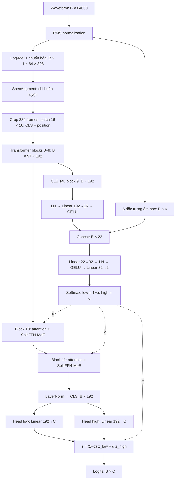
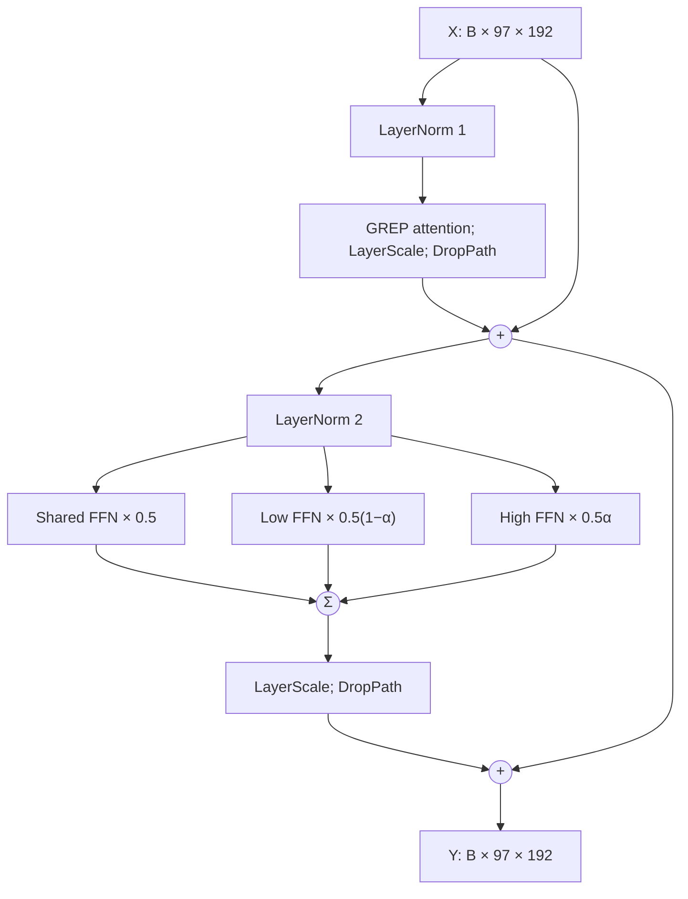

# Đặc tả phương pháp CED-SingleMoE-SplitFFN

Ngày đối chiếu mã nguồn và tài liệu: 03/11/2026.

## 1. Mục tiêu và phạm vi

CED-SingleMoE-SplitFFN là mô hình phân loại âm thanh dùng một backbone Transformer và cơ chế trộn chuyên gia theo điều kiện âm học. Mô hình giữ mười Transformer block đầu làm bộ trích xuất đặc trưng dùng chung, thay FFN tại hai block cuối bằng ba expert: Shared, Low-SNR và High-SNR. Router kết hợp đặc trưng phổ và CLS trung gian để dự đoán hệ số trộn liên tục α.

Tài liệu mô tả **triển khai hiện tại trong `src/models/ced_moe_split/`, đặc biệt luồng waveform `forward_full()`**. Đây là đặc tả mã nguồn, không phải xác nhận rằng các lựa chọn thiết kế đã tối ưu hoặc đã được chứng minh bằng thực nghiệm.

CED là nền tảng tham khảo cho backbone và distillation [1]. Các công trình V-MoE [2], Soft MoE [3] và DeepSeekMoE [4] được liệt kê trong mã nguồn tiền thân `../kd-moe-ced/src/models/split_moe.py`. Toàn bộ tổ hợp SplitFFN-MoE dưới đây không được xác định là bản sao nguyên mẫu của một bài báo duy nhất.

FRCRN, nếu có, là bước tạo waveform bên ngoài mô hình. Teacher BEATs [5] chỉ là thành phần huấn luyện tùy chọn.

## 2. Ký hiệu và cấu hình

| Ký hiệu/thuộc tính | Giá trị hoặc ý nghĩa |
|---|---|
| B | Batch size |
| C | Số lớp, mặc định 36 |
| Waveform | Mono, 16 kHz; cấu hình mô tả dùng 4 giây = 64.000 samples |
| D | Embedding dimension = 192 |
| N | 97 token: 96 patch token và 1 CLS |
| Backbone | `deit_tiny_patch16_224` từ timm, điều chỉnh đầu vào âm thanh |
| Transformer | 12 blocks, chỉ số 0–11 |
| Attention | 3 heads, head dimension 64 |
| Patch | Kernel và stride 16 × 16 |
| MoE blocks | `(10, 11)` |
| α | Gate High-SNR, shape B × 1 |
| Routing | Theo mẫu; mọi expert đều được tính |
| Đầu ra | Logits B × C |

## 3. Sơ đồ kiến trúc tổng thể

Nét liền biểu diễn dữ liệu; nét đứt biểu diễn gate điều khiển phép trộn.

## 4. Chuẩn hóa waveform

Với mỗi mẫu x có T samples:

$$
r=\sqrt{\frac{1}{T}\sum_t x_t^2},\qquad
\tilde{x}_t=x_t\frac{0.07925}{r+10^{-8}}.
$$

Hai frontend cùng nhận waveform đã chuẩn hóa. Phép này chuẩn hóa năng lượng tổng thể, không phải phép ước lượng hoặc thay đổi SNR giữa các thành phần của hỗn hợp.

## 5. Nhánh đặc trưng âm học

### 5.1. STFT

`AcousticFeatureExtractor` dùng FFT 512, Hann window 512, hop 160, `center=True`. Với 64.000 samples, phổ công suất có shape B × 257 × 401:

$$
P_{k,t}=|\operatorname{STFT}(\tilde{x})_{k,t}|^2+\epsilon,
\qquad \epsilon=10^{-8}.
$$

### 5.2. Sáu đặc trưng

| Đặc trưng | Phép tính theo mã |
|---|---|
| Log-RMS | Log của RMS waveform đã chuẩn hóa, có epsilon và clamp để ổn định |
| Crest factor | Biên độ tuyệt đối lớn nhất chia RMS cộng epsilon |
| Temporal kurtosis | Đặt e_t = Σ_k P_k,t; lấy mean của ((e_t − mean(e))/(std(e) + ε))⁴ |
| Spectral flatness | Trung bình theo thời gian của exp(mean_k(log P))/ (mean_k(P) + ε) |
| Low/speech ratio | log(E_low/E_speech), năng lượng mỗi dải được cộng epsilon |
| High/speech ratio | log(E_high/E_speech), năng lượng mỗi dải được cộng epsilon |

Các dải dùng chỉ số bin `0:10`, `10:109`, `109:257`. Đây là xấp xỉ các vùng thấp hơn 300 Hz, vùng tiếng nói 300–3.400 Hz và vùng cao hơn 3.400 Hz; độ phân giải bin là 31,25 Hz.

Kết quả ghép theo đúng thứ tự bảng:

$$
f_{\mathrm{spec}}\in\mathbb{R}^{B\times6}.
$$

**Giới hạn:** Log-RMS được tính sau RMS normalization nên gần hằng số với tín hiệu thông thường khác 0. Không nên mô tả đặc trưng này là năng lượng tuyệt đối của waveform gốc. Nhánh này cũng không cung cấp phép đo SNR tường minh.

## 6. Nhánh Log-Mel và token hóa

### 6.1. Frontend Log-Mel

| Tham số | Giá trị |
|---|---:|
| Sample rate | 16.000 Hz |
| FFT size | 512 |
| Hann window length | 400 |
| Hop | 160 |
| Mel scale | HTK |
| Mel bins | 64 |
| Dải tần | 20–8.000 Hz |
| STFT center | False |
| Padding phải trước STFT | 112 samples |
| Frames đầu ra | Crop/pad về 398 |

Sau Mel filterbank:

$$
L=\log(\operatorname{Mel}(P)+10^{-6}),\qquad
\hat{L}=\frac{L-\mu_{F,T}}{2(\operatorname{std}_{F,T}+10^{-5})}.
$$

Shape đầu ra là B × 1 × 64 × 398. Hệ số 2 ở mẫu số thuộc triển khai hiện tại.

### 6.2. SpecAugment

Trong chế độ train, mỗi mẫu dùng hai frequency masks rộng tối đa 8 bins và hai time masks rộng tối đa 24 frames; vùng mask được gán 0. Trong chế độ eval, module trả nguyên đầu vào.

### 6.3. Patch embedding

Mô hình lấy 384 frames đầu, rồi áp dụng `Conv2d(1,192,kernel_size=16,stride=16)`:

$$
B\times1\times64\times384
\rightarrow B\times192\times4\times24
\rightarrow B\times96\times192.
$$

Ghép một CLS token và cộng positional embedding học được shape 1 × 97 × 192. Sau position dropout và `norm_pre` theo backbone, chuỗi token có shape B × 97 × 192. Không sử dụng 14 frames cuối của tensor 398 frames trong patch embedding.

## 7. Backbone và GREP attention

Blocks 0–9 là Transformer dùng chung. Mỗi block có nhánh attention và FFN với residual theo cấu trúc Pre-LN. FFN kế thừa từ backbone DeiT-Tiny, với chiều 192 → 768 → 192 và GELU.

Mỗi attention được bọc bằng `BiasAttention`. Với 3 heads và d = 64:

$$
\operatorname{Attn}(Q,K,V)
=\operatorname{Softmax}\left(\frac{QK^\top}{\sqrt{64}}+S(Q)\odot P_{\mathrm{rel}}\right)V.
$$

Relative bias giữa patch được tạo bằng tổng embedding khoảng cách theo tần số và thời gian. Các tương tác CLS→patch, patch→CLS và CLS→CLS có tham số riêng. Block 0 sở hữu bảng bias; ma trận bias được tính một lần mỗi forward và tái sử dụng cho các block sau.

GREP gate được tính từ query bằng Linear 64→8, reshape thành hai nhóm 4 phần tử, sum từng nhóm rồi sigmoid để tạo g_a và g_b:

$$
S(Q)=g_a\big(g_b a_{\mathrm{GREP}}-1\big)+2.
$$

Mỗi block có tham số GREP riêng. **GREP gate không phải α**. Mã dự án mô tả attention này theo hướng BEATs-style; bài BEATs [5] là nguồn nền tảng liên quan, nhưng không được dùng để khẳng định biến thể 2D hiện tại là bản sao nguyên mẫu.

## 8. Router Spectral–Token và nguồn gốc α

Sau block 9, lấy CLS h_9 có shape B × 192:

$$
h_r=\operatorname{GELU}(W_p\operatorname{LN}(h_9)+b_p)
\in\mathbb{R}^{B\times16}.
$$

Ghép với đặc trưng âm học:

$$
v=[f_{\mathrm{spec}};h_r]\in\mathbb{R}^{B\times22}.
$$

MLP router:

$$
q=\operatorname{GELU}(\operatorname{LN}(W_1v+b_1))
\in\mathbb{R}^{B\times32},
$$

$$
[r_l,r_h]=W_2q+b_2\in\mathbb{R}^{B\times2}.
$$

Softmax tạo hai trọng số:

$$
\alpha=\frac{e^{r_h}}{e^{r_l}+e^{r_h}}
=\sigma(r_h-r_l),\qquad p_l=1-\alpha.
$$

Trong số học thực, 0 < α < 1; số học hữu hạn có thể bão hòa gần các biên.

**Hợp đồng gate:**

- Một α cho mỗi mẫu, không phải mỗi token hoặc mỗi head attention.
- Router chỉ chạy một lần sau block 9.
- Cùng α dùng cho block 10, block 11 và phép trộn logits.
- Không có `detach` h_9 trước router; gradient có thể đi ngược về backbone.
- α biểu diễn mức trộn học được, không phải SNR theo đơn vị dB.
- SNR thật không là đầu vào forward của router.

## 9. SplitFFN-MoE tại blocks 10 và 11

### 9.1. Cấu trúc block

Với X là đầu vào một block:

$$
U=X+\operatorname{DropPath}_1\left(\operatorname{LayerScale}_1\left(
\operatorname{Attn}(\operatorname{LN}_1(X))\right)\right),
$$

$$
V=\operatorname{LN}_2(U),
$$

$$
Y=U+\operatorname{DropPath}_2\left(\operatorname{LayerScale}_2(M(V,\alpha))\right).
$$

LayerScale và DropPath có thể là identity tùy cấu hình backbone.

### 9.2. Ba expert và phép trộn

Mỗi `SplitMoEFFN` tạo ba bản sao đầy đủ của MLP gốc, có trọng số độc lập sau khởi tạo:

$$
M(V,\alpha)=\frac12E_s(V)
+\frac12(1-\alpha)E_l(V)
+\frac12\alpha E_h(V).
$$

| Expert | Trọng số | Vai trò thiết kế |
|---|---:|---|
| Shared | 0.5 | Luôn đóng góp, biểu diễn chung |
| Low-SNR | 0.5(1−α) | Nhánh được định hướng cho vùng α thấp |
| High-SNR | 0.5α | Nhánh được định hướng cho vùng α cao |

Tổng trọng số bằng 1. Gate B × 1 được mở rộng thành B × 1 × 1 để broadcast qua token và channel.

### 9.3. Ý nghĩa chính xác của “Split” và “Shared”

- Mã hiện tại **sao chép toàn bộ FFN thành ba expert**, không chia hidden dimension thành các expert nhỏ.
- Cả ba expert được tính mỗi forward; đây là phép trộn mềm dày đặc, không phải sparse Top-k MoE.
- Shared expert là nhánh luôn đóng góp trong một block. Block 10 và block 11 không chia sẻ bộ trọng số expert với nhau.
- Hệ số 0.5 là hằng số trong mã, không học được.
- Nhãn Low/High mô tả định hướng huấn luyện; mức chuyên biệt hóa thực tế cần được đo.

### 9.4. Khởi tạo bảo toàn đầu ra FFN

Nếu ba expert đều cho cùng đầu ra E(V), thì:

$$
M(V,\alpha)=\left[0.5+0.5(1-\alpha)+0.5\alpha\right]E(V)=E(V).
$$

Tính chất này áp dụng khi các expert cho đầu ra giống nhau, ví dụ khi sao chép cùng trọng số và dropout bị tắt. Dropout độc lập có thể làm các đầu ra khác nhau trong chế độ train. Đây là bảo toàn ở cấp module FFN, không chứng minh toàn mô hình trùng với một checkpoint pretrained gốc.

## 10. Hai classifier heads

Sau block 11, áp dụng LayerNorm cuối và lấy CLS h_f ∈ R^(B×192):

$$
z_l=W_lh_f+b_l,\qquad z_h=W_hh_f+b_h,
$$

$$
z=(1-\alpha)z_l+\alpha z_h\in\mathbb{R}^{B\times C}.
$$

Hai head là hai Linear 192→C độc lập. Phép trộn diễn ra trên logits trước softmax. API mặc định trả logits; xác suất lớp là softmax(z), nhãn dự đoán là argmax(z).

## 11. Mục tiêu huấn luyện

Các giá trị dưới đây là mặc định của `MoETrainer`; runner có thể truyền giá trị khác.

### 11.1. Classification loss

Cross-entropy trên logits hợp nhất với label smoothing 0.05. Nếu target là vector hai chiều, trainer lấy argmax để tạo chỉ số lớp; triển khai này xử lý phân loại một nhãn, không giữ nguyên soft target nhiều lớp.

### 11.2. Giám sát router

Từ SNR thật s trong dữ liệu huấn luyện:

$$
\alpha^*=\sigma\left(\frac{s-15}{2.5}\right),
\qquad
\mathcal{L}_{router}=\operatorname{BCE}(\alpha,\alpha^*).
$$

Trong BCE, α được clamp vào [10⁻⁶, 1−10⁻⁶]. Tại 15 dB, mục tiêu bằng 0.5. Mốc 15 dB và độ chuyển tiếp 2.5 dB là siêu tham số của dự án, chưa được xác định là công thức lấy từ các bài [1]–[5].

Trainer hiện dùng SNR = 0 dB nếu batch thiếu `snr_db`; vì vậy dữ liệu huấn luyện cần cung cấp metadata SNR đúng để tránh mục tiêu router sai.

### 11.3. Knowledge distillation tùy chọn

Teacher được đóng băng và đặt eval. Với nhiệt độ T = 2:

$$
p_t=\operatorname{Softmax}(z_t/T),\quad
p_s=\operatorname{Softmax}(z/T),\quad
\mathcal{L}_{KD}=T^2\operatorname{KL}(p_t\Vert p_s).
$$

BEATs [5] là teacher được mô tả trong tài liệu dự án; lớp trainer nhận một teacher tùy chọn qua đối số.

### 11.4. Tổng loss và tối ưu

$$
\mathcal{L}=0.50\mathcal{L}_{CE}
+0.20\mathcal{L}_{router}
+0.50\mathcal{L}_{KD}.
$$

Không có teacher thì hệ số KD bằng 0; các hệ số còn lại không được tự chuẩn hóa lại. CE và KD có thể truyền gradient tới router qua cả trộn expert và trộn classifier.

| Thuộc tính trainer | Mặc định |
|---|---:|
| Optimizer | AdamW |
| Epochs | 15 |
| LR backbone | 5 × 10⁻⁵ |
| LR nhóm experts/heads dự kiến | 1.5 × 10⁻⁴ |
| LR router | 2 × 10⁻⁴ |
| Weight decay backbone/heads | 0.05 |
| Weight decay router | 10⁻⁴ |
| Warmup | 2 epochs, sau đó cosine |
| Gradient clipping | Max norm 5 |
| Checkpoint | Validation Top-1 accuracy cao nhất; hòa giữ checkpoint trước |

**Sai khác triển khai cần lưu ý:** trainer nhận diện nhóm expert bằng chuỗi `moe_blocks` trong tên tham số. Tuy nhiên các expert được đăng ký dưới `vit.blocks.*.mlp.*`, còn `moe_blocks` là dictionary thường. Theo luồng đăng ký hiện tại, expert đi vào nhóm backbone; hai head đi vào nhóm experts/heads. Bảng LR phải được hiểu cùng hạn chế này, không được khẳng định mọi expert đang dùng LR 1.5 × 10⁻⁴.

## 12. Hợp đồng đầu vào và đầu ra

### 12.1. Luồng waveform được đặc tả

- `forward(waveform)` → logits B × C.
- `forward(waveform, return_features=True)` → (logits, CLS cuối).
- `forward(waveform, return_dict=True)` → dictionary trung gian.
- `extract_features(waveform)` → CLS cuối B × 192.

Dictionary gồm `logits`, `logits_low`, `logits_high`, `alpha`, `gates`, `spectral_feat`, `block9_token`, `cls_final`.

### 12.2. Nhánh spectrogram trực tiếp

Đầu vào bốn chiều đi qua `forward_features()` thay vì `forward_full()`. Nhánh này dùng vector đặc trưng âm học bằng 0 để router tính α cho MoE; classifier lại dùng trung bình hai head 0.5/0.5. Vì vậy hai nhánh không tương đương về routing và phép trộn đầu ra. `return_dict=True` cũng không tạo dictionary như nhánh waveform.

### 12.3. Huấn luyện và suy luận

| Thành phần | Huấn luyện | Suy luận waveform |
|---|---|---|
| Waveform và hai frontend | Có | Có |
| SpecAugment | Bật | Tắt |
| Router dự đoán α | Có | Có |
| SNR thật | Tạo mục tiêu router | Không cần |
| Teacher | Tùy chọn | Không cần |
| Ba expert mỗi block | Đều chạy | Đều chạy |
| Hai classifier heads | Đều chạy | Đều chạy |

## 13. Vì sao đặt MoE ở hai block cuối?

Lựa chọn blocks 10–11 giữ phần lớn backbone dùng chung và cho phép biến đổi có điều kiện qua hai tầng liên tiếp. Block 11 nhận biểu diễn đã được block 10 điều chỉnh, đồng thời có attention và expert riêng.

Đây là **lập luận thiết kế**, chưa phải bằng chứng hai block tốt hơn một block. Không được viện dẫn V-MoE, Soft MoE hoặc DeepSeekMoE như bằng chứng trực tiếp cho lựa chọn chính xác `(10,11)` trong bài toán này.

Ablation tối thiểu nên gồm:

| Cấu hình | Mục đích |
|---|---|
| Backbone không MoE | Baseline |
| MoE chỉ ở block 11 | Đánh giá một tầng thích nghi |
| MoE ở blocks 10–11 | Đánh giá hai tầng thích nghi |
| Hai block, α cố định 0.5 | Đánh giá ích lợi routing thích nghi |
| Router chỉ dùng CLS / chỉ dùng phổ / kết hợp | Đánh giá từng nguồn thông tin |

Giữ cùng split dữ liệu, frontend, pretrained, seed, loss, ngân sách huấn luyện và quy tắc chọn checkpoint. Báo cáo accuracy tổng thể, accuracy theo SNR, số tham số, chi phí tính toán, latency và biến thiên qua nhiều seed. So sánh một và hai block đồng thời thay đổi số tham số, nên cần ghi rõ yếu tố năng lực mô hình này.

**Lỗi cần tránh khi ablation:** forward hiện chạy blocks 0–9 rồi chỉ chạy các chỉ số trong `split_blocks`. Đặt `(11,)` trực tiếp sẽ bỏ qua block 10. Cần sửa vòng lặp để mọi block vẫn chạy, chỉ thay loại FFN ở vị trí được chọn.

## 14. Nguồn gốc phương pháp và giới hạn trích dẫn

| Thành phần | Nguồn tham khảo | Quan hệ và giới hạn |
|---|---|---|
| CED và audio Transformer student | [1] | Nền tảng; không phải nguồn cho toàn bộ router SNR hiện tại |
| MoE trong Vision Transformer | [2] | Tham khảo kiến trúc; V-MoE là sparse routing, khác phép trộn ba expert đều chạy |
| Soft assignment khả vi | [3] | Nguồn liên quan; Soft MoE trộn token vào expert slots, không phải gate vô hướng α theo mẫu ở đây |
| Shared và routed experts | [4] | Nguồn trực tiếp về ý tưởng shared-expert isolation; DeepSeekMoE còn có fine-grained segmentation và sparse routing |
| Teacher âm thanh, BEATs-style attention | [5] | Nguồn teacher và kiến trúc liên quan; chưa chứng minh mọi sửa đổi 2D GREP là bản sao nguyên mẫu |
| Router 6+16→22→32→2 | Mã dự án | Thiết kế hiện tại; chưa xác định nguồn công bố đúng cấu hình |
| Trọng số 0.5; 0.5(1−α); 0.5α | Mã dự án | Không quy gán công thức này cho [4] |
| Mục tiêu sigmoid((SNR−15)/2.5) | Mã dự án | Siêu tham số cần kiểm nghiệm |
| MoE blocks 10–11 và dual heads dùng chung α | Mã dự án | Cần ablation; chưa xác lập tính mới khoa học |

Việc một tài liệu được liệt kê trong docstring chứng minh quan hệ tham khảo do dự án ghi nhận, không tự chứng minh triển khai tái lập đúng bài báo. Các phần gọi là “thiết kế của dự án” cũng không đồng nghĩa đã xác lập tính mới qua khảo sát đầy đủ tài liệu.

Đoạn mô tả có thể dùng trong báo cáo:

> Chúng tôi xây dựng mô hình phân loại âm thanh trên backbone CED [1], tham khảo việc tích hợp MoE vào Transformer [2] và cơ chế shared/routed experts của DeepSeekMoE [4]. Mô hình sử dụng router kết hợp đặc trưng phổ với CLS trung gian để điều khiển ba FFN expert tại hai block cuối và hợp nhất hai đầu phân loại. Cơ chế trộn là khả vi nhưng khác cơ chế token-slot của Soft MoE [3]. Số block MoE và các siêu tham số routing là lựa chọn thiết kế cần được đánh giá bằng ablation. BEATs [5] có thể được sử dụng làm teacher trong huấn luyện.

## 15. Kiểm chứng và giới hạn triển khai

- **Pretrained:** loader lọc key theo tên và shape. Việc bọc attention và đổi tên FFN làm thay đổi key; cần kiểm kê key nạp thành công, missing/unexpected keys và checksum checkpoint trước khi khẳng định toàn bộ backbone/expert được khởi tạo pretrained. Loader hiện bỏ qua ngoại lệ bằng `except Exception: pass`.
- **Số tham số:** nhãn khoảng 6.62M trong tài liệu chưa được đo lại trong lần lập đặc tả này. Dùng `get_num_params()` của model đã khởi tạo để báo cáo số thực; không coi nhãn là kết quả kiểm chứng.
- **Tốc độ:** mọi expert đều chạy nên không thể suy ra lợi ích giảm FLOPs từ các kết quả sparse MoE trong bài nền tảng.
- **Chuyên biệt hóa:** cần đo gate theo SNR và hiệu quả từng nhánh; tên expert không đảm bảo tự hình thành chuyên biệt hóa như kỳ vọng.
- **Kết quả:** tài liệu này không xác nhận lại các con số accuracy trong README hoặc log lịch sử.
- **Trạng thái kiểm tra:** đã đối chiếu tĩnh mã nguồn và metadata bài báo; không chạy huấn luyện, benchmark hoặc kiểm thử model khi tạo tài liệu.

## 16. Ánh xạ sang mã nguồn

| Nội dung | Vị trí |
|---|---|
| Khởi tạo backbone, forward waveform, hai head, pretrained | [model.py](src/models/ced_moe_split/model.py) |
| RMS, đặc trưng âm học, Log-Mel, SpecAugment | [acoustic_frontend.py](src/models/ced_moe_split/acoustic_frontend.py) |
| Spectral–Token router và router loss | [router.py](src/models/ced_moe_split/router.py) |
| Ba FFN expert và phép trộn | [split_ffn.py](src/models/ced_moe_split/split_ffn.py) |
| GREP và relative position bias | [attention.py](src/models/ced_moe_split/attention.py) |
| Loss, optimizer, checkpoint selection | [trainer.py](src/models/ced_moe_split/trainer.py) |
| Các test hiện có; chưa chạy trong lần lập tài liệu | [test_moe.py](tests/test_moe.py) |
| Danh sách bài tham khảo trong mã tiền thân | [split_moe.py](../kd-moe-ced/src/models/split_moe.py) |

## 17. Tài liệu tham khảo

[1] Heinrich Dinkel, Yongqing Wang, Zhiyong Yan, Junbo Zhang, và Yujun Wang. **CED: Consistent ensemble distillation for audio tagging.** Bản arXiv năm 2023, arXiv:2308.11957. [Bài báo](https://arxiv.org/abs/2308.11957). [Mã nguồn chính thức](https://github.com/RicherMans/CED). Dùng định danh arXiv để tránh nhầm năm bản thảo với năm công bố hội nghị.

[2] Carlos Riquelme, Joan Puigcerver, Basil Mustafa, Maxim Neumann, Rodolphe Jenatton, André Susano Pinto, Daniel Keysers, và Neil Houlsby. **Scaling Vision with Sparse Mixture of Experts.** 2021. arXiv:2106.05974. [Bài báo](https://arxiv.org/abs/2106.05974).

[3] Joan Puigcerver, Carlos Riquelme, Basil Mustafa, và Neil Houlsby. **From Sparse to Soft Mixtures of Experts.** ICLR 2024; bản thảo ban đầu năm 2023. arXiv:2308.00951. [Bài báo](https://arxiv.org/abs/2308.00951).

[4] Damai Dai và cộng sự. **DeepSeekMoE: Towards Ultimate Expert Specialization in Mixture-of-Experts Language Models.** ACL 2024, tr. 1280–1297. arXiv:2401.06066. [Bài báo](https://arxiv.org/abs/2401.06066). [Bản proceedings](https://aclanthology.org/2024.acl-long.70.pdf).

[5] Sanyuan Chen, Yu Wu, Chengyi Wang, Shujie Liu, Daniel Tompkins, Zhuo Chen, Wanxiang Che, Xiangzhan Yu, và Furu Wei. **BEATs: Audio Pre-Training with Acoustic Tokenizers.** ICML 2023, PMLR 202:5178–5193. [Bản proceedings và BibTeX](https://proceedings.mlr.press/v202/chen23ag.html). [Mã nguồn chính thức](https://github.com/microsoft/unilm/tree/master/beats). Danh sách tác giả ở đây theo bản proceedings; có thể khác metadata bản arXiv ban đầu.
